# Agent 工作流程图集

用图把七张导图描述的流程梳理一遍,作为动手写代码之前的设计依据。图用 Mermaid 写成,GitHub 会直接渲染。

- 流程的文字说明见蓝图页面;本文件只放图和读图要点。
- 阶段名沿用导图里的大写动词。来源写法 `3.2.4` 表示第 3 张图第 2 个分支第 4 条。
- 图里的实线是主路径,虚线是异常或旁路。

| 图 | 类型 | 对应导图 |
|---|---|---|
| 图 0 总体活动图 | 活动图 | 图 7 Workflow(整合前六张) |
| 图 1 职责泳道图 | 泳道图 | 图 1 Control |
| 图 2 定义阶段活动图 | 活动图 | 图 2 Decisions |
| 图 3a 闸门判定活动图 | 活动图 | 图 3 Authorize |
| 图 3b 批准时序图 | 时序图 | 图 3 Authorize |
| 图 4a 任务状态机 | 状态机图 | 图 4 Persist |
| 图 4b 恢复活动图 | 活动图 | 图 4 Persist |
| 图 5 场景时序图 | 时序图 | 图 5 Workflows |
| 图 6 收尾与度量活动图 | 活动图 | 图 6 Economics |
| 图 7 组件图 | 组件图 | 技术栈 |
| 图 8 数据模型 | ER 图 | 图 1 的 1.5.2,图 4 |

## 图 0 总体活动图

对应图 7 的五个分支:PREPARE、ADMIT、FRAME、ACT、CLOSE。设计期只做一次,运行期每个任务走一遍,学习期的结论回头改设计。

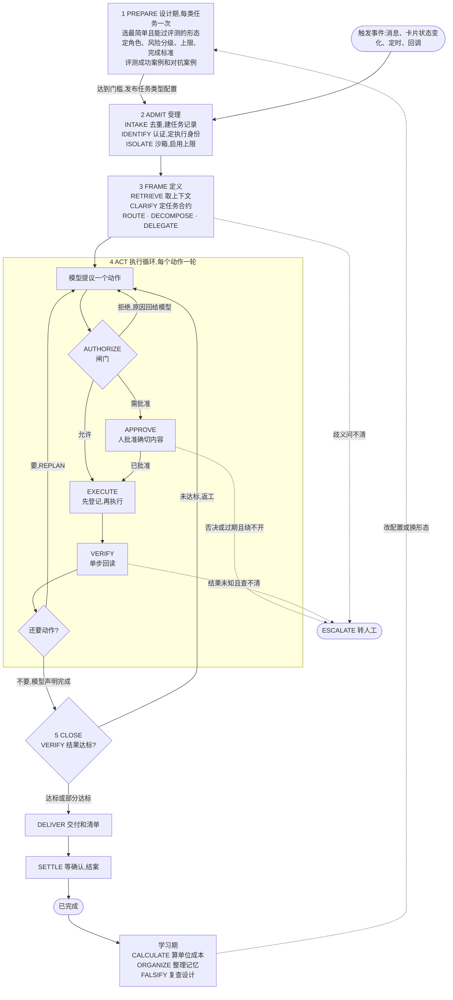

## 图 1 职责泳道图:一个动作经过哪几层

对应图 1 的职责分层(1.3)和最小循环(1.4)。模型只提议,Harness 排序和记账,企业后端做决定并执行,人只决定不可逆的事,效果发生在业务系统里。

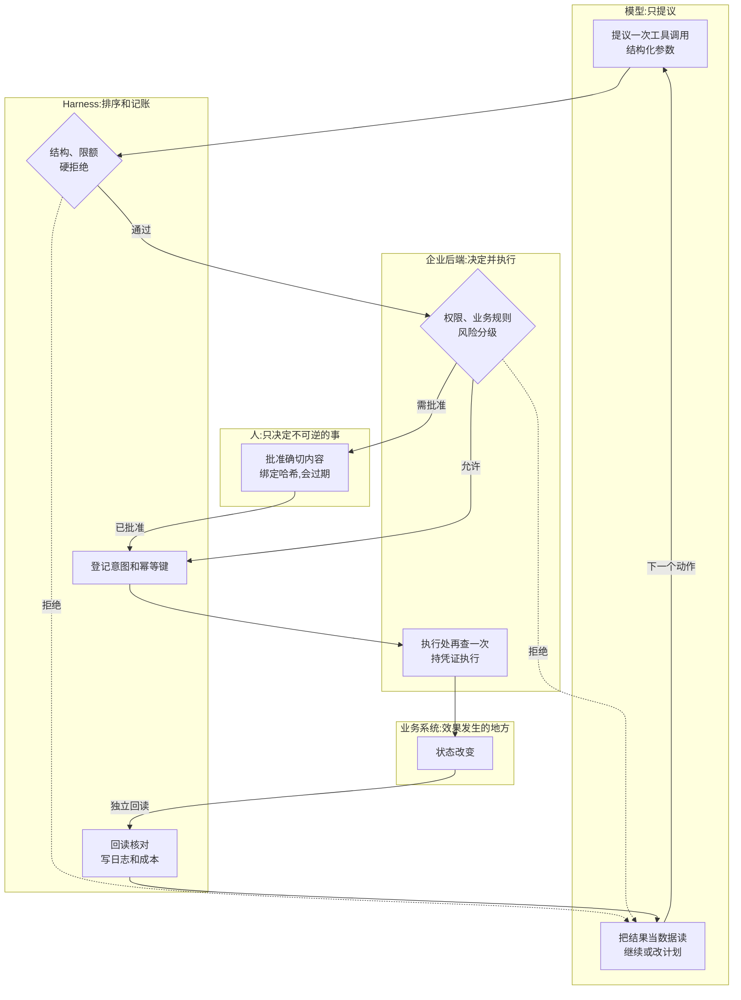

## 图 2 定义阶段活动图

对应图 2 的 CLARIFY、DECOMPOSE、REPLAN、ROUTE、DELEGATE。新增的部分是向发起人提问,以及不可撤销步骤后置。

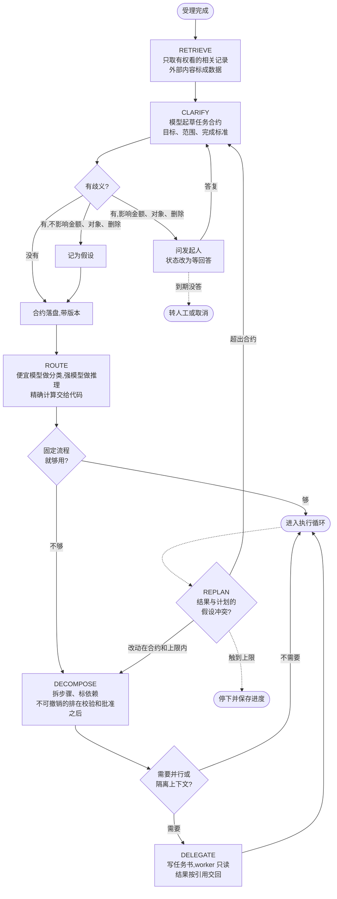

## 图 3a 闸门判定活动图

对应图 3 的 IDENTIFY、AUTHORIZE、APPROVE。每次调用按固定顺序过九道检查,结果只有允许、拒绝、交人批准三种。

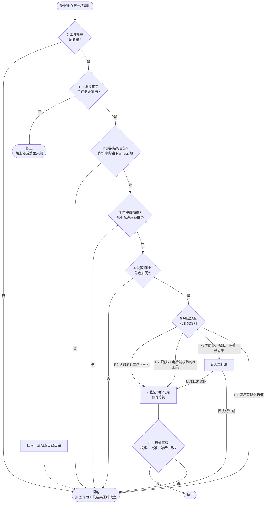

## 图 3b 批准时序图

对应图 3 的 APPROVE。批准有两种形式:在流程内批准,或在业务系统里批准。付款类优先用后一种,Agent 只创建待批准的请求。

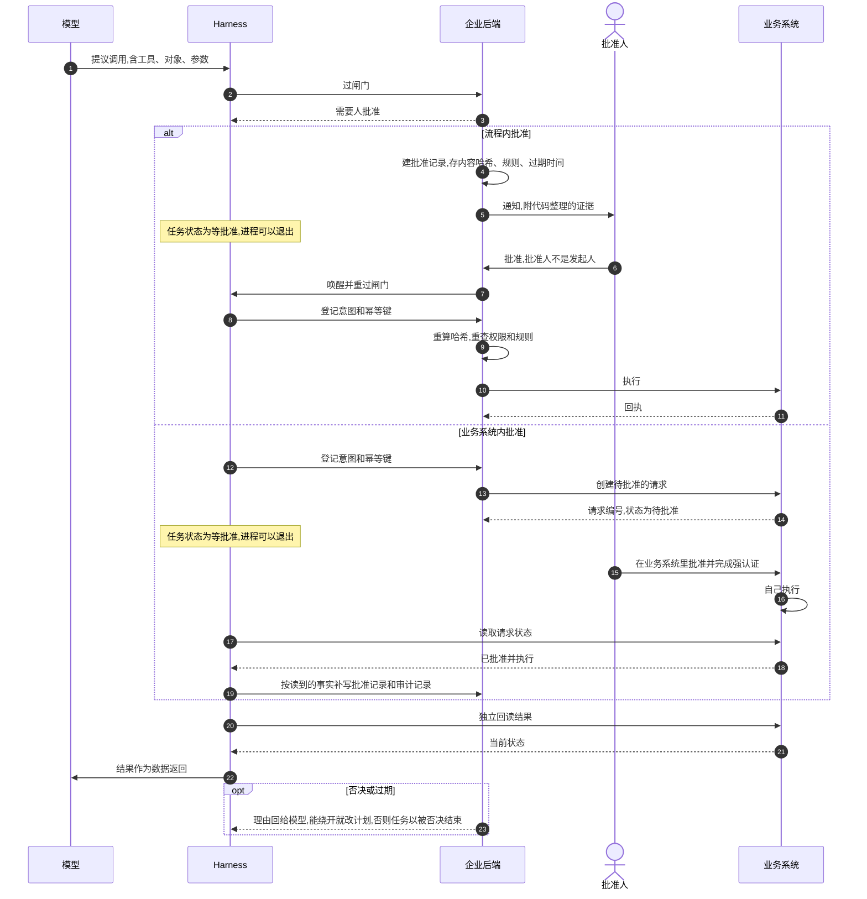

## 图 4a 任务状态机

对应图 4 的 TRACK。导图给了待处理、运行中、等待批准、失败或完成;其余八个状态是补充的。每个等待状态都有负责人、期限和到期动作。

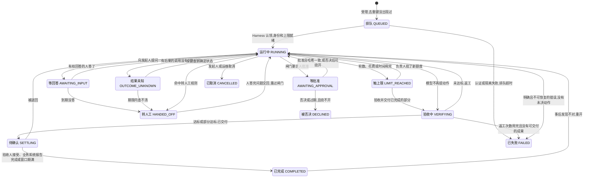

终止状态有五个:已完成、已失败、转人工、被否决、已取消。每个终止出口都要通知发起人并关闭成本台账。为了图面清楚,没有画它们到终点的箭头。

## 图 4b 恢复活动图

对应图 4 的 RECOVER。Harness 每次启动都走这条路径,首次启动只是没有东西要对账的特例。

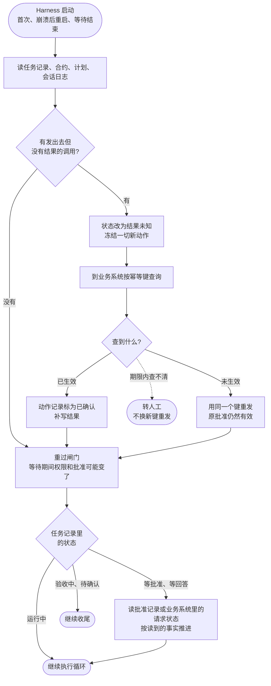

## 图 5 场景时序图:研究加模拟下单

对应图 5 的四类工作。这里画的是本仓库建议的第一条路径:研究一个标的,生成下单请求,人批准,模拟盘执行,回读核对。券商一侧先接模拟盘。

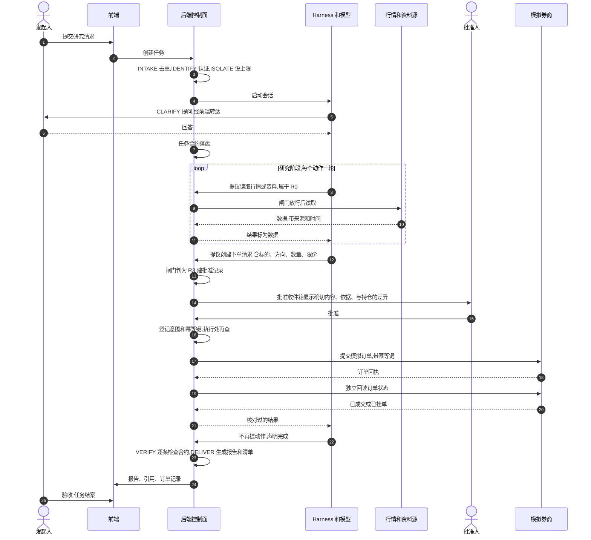

## 图 6 收尾与度量活动图

对应图 6 的 CALCULATE 和 FALSIFY,以及图 7 的 CLOSE。虚线表示向成本台账写数据的时点,事后重建的数字会漏掉失败的尝试和人工分钟数。

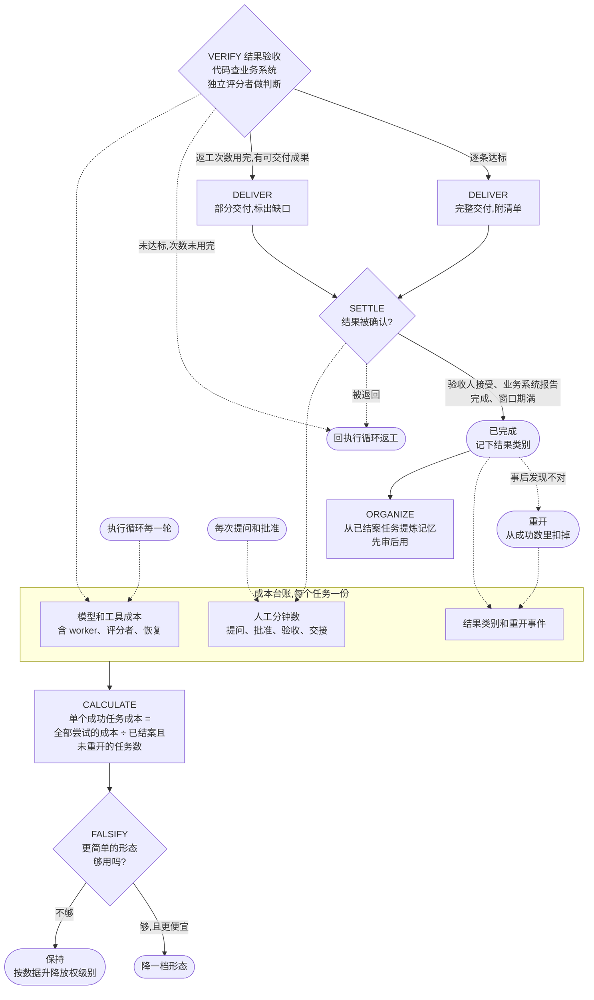

## 图 7 组件图

按选定的技术栈画。闸门、记录和工具执行都在你自己的后端里;Anthropic 托管的只有循环、会话日志和沙箱,隔在适配层后面。

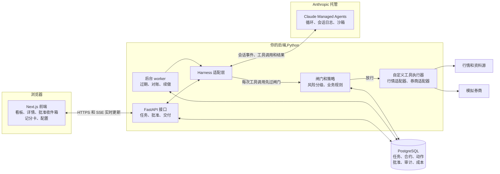

## 图 8 数据模型

对应图 1 的「业务状态记在模型之外」(1.5.2)和图 4 的记录。字段只列关键的,落库时再细化。

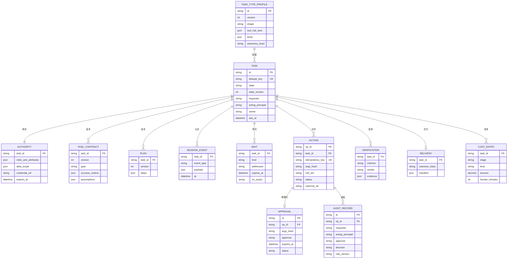
