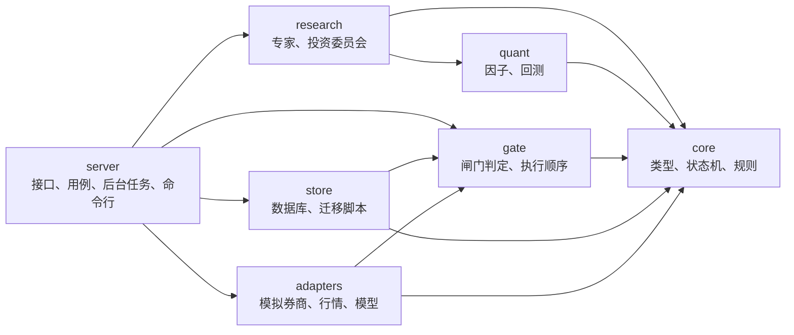
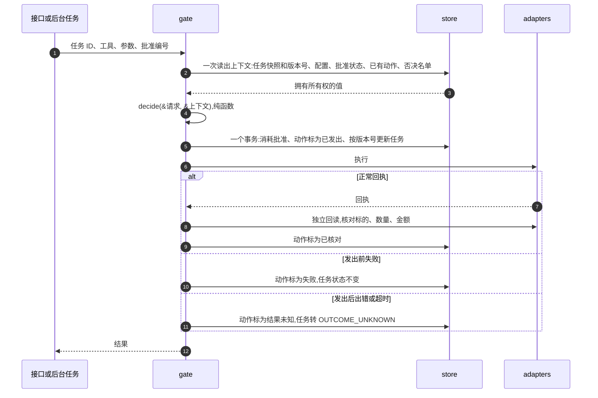

# Rust 后端规划

后端只保留 Rust。Gemini 正在把 trade_ai 迁移到 Rust;迁移结束后,由我按本文合并、改进,并移植 Python 骨架里的控制面。本文依据 `docs/diagrams.md` 的 11 张图(编号沿用)。

目标有三个:低耦合、高内聚、代码少。Rust 有三个常见难点,本文给出统一写法:

- 所有权和生命周期需要换一种思路;
- 复杂的图结构和循环引用写起来别扭;
- 改一点就要重新编译,不利于高频试错。

第 8 节是截至目前的改进清单,也是 Gemini 结束后我要做的事。

## 1. 三条总原则

| 原则 | 做法 | 解决的难点 |
|---|---|---|
| 数据库是唯一的真相 | 任务、动作、批准、结论都存在库里;内存里不保留对象之间互相指向的结构 | 循环引用 |
| 纯核心,外壳做副作用 | 业务规则写成纯函数,不碰数据库也不碰网络;读写数据库、调用外部系统只在最外层 | 生命周期、试错速度 |
| 关系用 ID,不用引用 | 任务和动作、动作和批准之间用 ID 关联,需要时查库 | 所有权、循环引用 |

## 2. crate 划分



| crate | 内容 | 对应的图 | 有无 IO |
|---|---|---|---|
| core | ID、金额、日期、任务状态和迁移表、风险分级、批准和验收规则、合约和计划 | 图 2、4a、8 | 无 |
| quant | 因子打分、回测 | 图 5 | 无 |
| research | 三个专家、投资委员会、组合构建 | 图 2、5 | 无 |
| gate | 闸门的纯判定和执行顺序;定义 `Tool` 和 `GateLedger` 两个接口 | 图 1、3a、3b | 无,只定义接口 |
| store | 唯一访问数据库的地方:迁移脚本、按 ID 读写、带版本号的更新、事务;实现 `GateLedger` | 图 4a、4b、8 | 有 |
| adapters | 外部系统:模拟券商、行情来源、模型接口;实现 `Tool` | 图 1、7 | 有 |
| server | 用例、HTTP 接口和事件流、到期处理、命令行 | 图 0、3b、6、7 | 有 |

三条规则:

- 依赖只朝下。core、quant、research、gate 不依赖任何有 IO 的 crate。
- 只有 store 写 SQL,只有 adapters 发网络请求,只有 server 把它们串起来。
- sqlx、axum、tokio、reqwest 这些重依赖只出现在 store、adapters、server。改业务规则时不用重新编译它们。

从 Gemini 的代码过来:

| 现在 | 合并后 |
|---|---|
| trade-core | core。保留金额、权重、日期、不可信文本、任务状态、错误类型 |
| trade-quant | quant |
| trade-workers(已含 committee) | research |
| trade-gate | gate。保留它的 `Tool`、`GateLedger` 两个接口,判定部分按第 5 节改成纯函数 |
| trade-store(待写) | store |
| trade-broker | adapters |
| trade-cli | server 的子命令 |
| Python 骨架 `backend/` | 等待和到期、审计、记分卡、`/v1` 接口移植过来后删除 |

## 3. 所有权和生命周期:六条写法约定

| 约定 | 做法 |
|---|---|
| 领域类型拥有自己的数据 | 用 `String`、`Vec`、newtype;结构体里不存引用,领域代码里不出现生命周期参数 |
| 输入借用,输出新值 | 函数参数用 `&T`,返回拥有所有权的结果;判定函数不修改输入 |
| 关系用 ID | `TaskId`、`ApprovalId`、`IdempotencyKey` 这类 newtype;不用 `Rc`、`RefCell` 或裸指针拼对象图 |
| 共享的只有只读的东西 | 配置、连接池、事件广播放在 `Arc<AppState>` 里;可变状态只放数据库,不长期放在 `Mutex` 里 |
| 不跨 `.await` 持有借用 | 用例每一步从库里重新读,写回时带版本号;读出来的值在本函数里用完 |
| 错误用枚举 | 用 thiserror 定义错误类型,至少区分「请求发出前失败」和「发出后结果不明」;anyhow 只在程序入口用 |

另外一条:先克隆,后优化。小值随便克隆;只有回测这类测得出来的热点,再考虑借用和零拷贝。

## 4. 图结构和循环怎么写

| 图里的结构 | Rust 里的写法 |
|---|---|
| 图 4a 状态机,有环(等待和运行来回、结案后重开) | 一个枚举加一张 `match` 迁移表;环只是表里的一行,不存在节点对象 |
| 图 0、图 1 的执行循环(提议、闸门、执行、回读、再提议) | 循环体是一个 async 函数,每轮从库里读、写回;由后台任务或请求驱动,不递归 |
| 图 2 的计划依赖 | `Vec<PlanStep>`,每步带 `depends_on: Vec<StepId>`;用拓扑排序检查有没有环、找出可以并行的步骤,不需要图库 |
| 图 2 的分派(主 Agent 和 worker) | 任务书和结果都是值,用 `JoinSet` 并行;worker 之间不共享可变状态 |
| 图 3b 批准(任务等批准,批准指回任务) | 两张表用 ID 互相指向;「消耗批准」和「标记已发出」在同一个数据库事务里完成 |
| 图 8 的一对多、多对一 | 外键加查询;Rust 里没有双向指针 |
| 图 7 的事件流 | tokio 的 broadcast 通道,每个订阅者持有自己的接收端 |

## 5. 一次执行步骤里,数据归谁



每一步都从库里读出完整的上下文,算出结果,再带版本号写回。闸门不在 `.await` 之间一直持有任务的可变引用,所以不需要生命周期标注;批准人中途操作时,写回会因为版本号不符而失败,然后重读再判断。动作已经登记过的,按幂等键认出来,不会再执行一次。

Gemini 已经写好的 `Tool` 和 `GateLedger` 两个接口保留,只把判定部分抽成纯函数,大致是这样:

```rust
/// 全部从库里一次读出,不来自提议方。
pub struct GateContext {
    pub task: TaskSnapshot,            // 状态、版本号、上限计数、开始时间
    pub config: TaskTypeConfig,
    pub approval: Option<ApprovalStatus>,
    pub existing_intent: Option<ActionIntentRecord>,
    pub vetoed: BTreeSet<Ticker>,
    pub now: Timestamp,
}

pub struct GateRequest<A> {
    pub task_id: TaskId,
    pub target: String,
    pub args: A,
    pub idempotency_key: IdempotencyKey,
    pub approval_id: Option<ApprovalId>,
}

pub enum Verdict {
    Proceed { payload_hash: String },
    NeedsApproval { payload_hash: String },
    Replay { receipt_id: String },
    Deny(PreDispatchError),
}

/// 按图 3a 的顺序逐项检查:先拒绝,后求批准。不做任何 IO,测试不需要数据库和 tokio。
pub fn decide<T: Tool>(tool: &T, req: &GateRequest<T::Args>, ctx: &GateContext) -> Verdict { /* … */ }
```

## 6. 高频试错:改了之后多快能看到结果

| 要反复试的东西 | 放在哪里 | 改了之后 |
|---|---|---|
| 策略参数:因子权重、否决阈值、仓位上限、分歧度阈值 | `config/strategy.toml` | 不用重新编译;回测命令可以一次跑多组参数 |
| 风险分级、上限、放权级别 | 任务类型配置,存在数据库里 | 不用重新编译,也不用重启 |
| 演示和测试用的市场数据 | `fixtures/` 下的数据文件 | 不用重新编译 |
| 提示词和评分标准 | `prompts/` 下的文本文件 | 不用重新编译 |
| 状态机、闸门判定、批准和验收规则 | core 和 gate 里的纯函数 | `cargo test -p core -p gate` 几秒出结果,不需要数据库 |
| 迁移有没有改变行为 | Python 版的基准结果文件 | 每次测试自动比对 |
| 前端联调 | 保留 `/v1/dev` 下的模拟和演示数据 | 不需要真的 Agent |

工具:bacon(保存即检查)、cargo nextest、insta(快照测试)、proptest(属性测试)。sqlx 用运行时查询,编译时不需要连数据库。

测试分四层:

| 层 | 测什么 | 怎么测 |
|---|---|---|
| core、gate | 状态机永远走不到非法状态;已完成只能从待确认进入;闸门九步的顺序 | 属性测试随机生成事件序列;闸门用表驱动测试,不需要异步 |
| quant、research | 和 Python 版结果一致:4 个调仓日的分数、否决、权重、回测指标 | 快照比对,浮点按容差 |
| store | 迁移、带版本号的更新、批准的原子消耗、并发冲突 | 每个测试一个新的 SQLite 库;CI 里再用 PostgreSQL 跑一遍 |
| server | 接口行为、第一轮审查复现的 4 个问题 | 进程内调用 axum,移植骨架的 31 个接口测试 |

如果策略研究需要比改配置更自由的探索,可以另开一个只读的笔记本环境连同一个数据库,它不属于后端代码。

## 7. 每张图落在哪里

| 图 | 落点 | 怎么验证 |
|---|---|---|
| 图 0 总体活动图 | server 的用例,一个阶段一个函数 | 端到端测试走完全程 |
| 图 1 职责泳道 | crate 边界本身:core 规则、gate 判定、store 记账、adapters 执行、server 编排 | 依赖方向由 Cargo 保证 |
| 图 2 定义阶段 | core 的合约和计划;计划步骤的依赖检查 | 单元测试:有环的计划被拒绝 |
| 图 3a 闸门 | gate 的 `decide` | 表驱动测试覆盖九步顺序 |
| 图 3b 批准 | store 的批准表和事务,server 的批准用例 | 回归测试:同一个批准不能用两次 |
| 图 4a 状态机 | core 的迁移表,store 的带版本号更新 | 属性测试,迁移表和图逐行对照 |
| 图 4b 恢复 | server 启动时扫描「已发出」和「结果未知」的动作 | 用模拟券商的故障注入测试 |
| 图 5 场景 | 命令行 demo 和端到端测试 | 和 Python 基准比对 |
| 图 6 收尾与度量 | server 的验收、交付、结案;验收只读库里的数据 | 回归测试:空结论不能通过验收 |
| 图 7 组件 | crate 划分本身 | 无需单测 |
| 图 8 数据模型 | store 的迁移脚本 | SQLite 和 PostgreSQL 都跑一遍迁移 |

## 8. 改进清单(截至 2026-11-26 23:20 的快照)

### 8.1 迁移收尾:M0,Gemini 在做,没做完的由我接手

| 编号 | 问题 | 位置 | 改法 | 验证 |
|---|---|---|---|---|
| A1 | 工作区编译不过:trade-store 已登记,但还不存在 | `Cargo.toml` | 写 store,实现 `GateLedger` | `cargo build` 通过 |
| A2 | 因子截尾会让程序崩溃:浮点误差使下限略大于上限,`f64::clamp` 直接 panic | `trade-quant/src/factors.rs:78` | 改成 `v.max(lo).min(hi)`,或先保证下限不大于上限 | 补「整列取值相同」的测试 |
| A3 | 闸门测试编译不过:禁止 `unsafe` 的 crate 里用了 `unsafe`;闸门没有测试 | `trade-gate/src/lib.rs:521` | 改用 `#[tokio::test]`,判定部分改成纯函数后可以直接测 | 闸门测试通过 |
| A4 | 命令行是空的 `main`,没法端到端运行 | `trade-cli/src/main.rs` | demo 命令输出分数、否决、权重、回测指标 | 和 Python 基准一致 |

23:28 的进展:A3 已完成,闸门的 2 个测试通过。A1 的 store 已经写出,批准的消耗和「已发出」记录在同一个事务里,并用带状态条件的更新防止重复消耗;但工作区的 sqlx 依赖缺少 `macros` 特性,`sqlx::migrate!` 编译不过。A2、A4 还没动。

### 8.2 所有权和生命周期

| 编号 | 问题 | 位置 | 改法 | 验证 |
|---|---|---|---|---|
| B1 | 闸门在 36 处 `.await` 之间一直持有 `&mut TaskRecord`,中途多次保存。批准人并发操作时,手里这份会过期并覆盖新状态 | `trade-gate` | 按第 5 节:一次读出上下文,纯函数判定,写库集中到一个带版本号的事务,冲突就重读 | 并发测试:闸门运行中批准被否决,闸门不会用旧状态覆盖 |
| B2 | ID 全是字符串,闸门有 9 个 ID 参数,幂等键和批准编号容易传反 | `trade-gate`、`trade-core` | `TaskId`、`ApprovalId`、`IdempotencyKey` 等 newtype | 传错类型编译不过 |
| B3 | `evaluate_and_execute` 有 11 个参数 | `trade-gate` | 合成 `GateRequest` | 无需单测 |
| B4 | `Tool` 接口里执行和回读的错误还是字符串 | `trade-gate` | 错误枚举区分「没发出去」和「结果不明」 | 没发出去的错误不触发对账 |
| B5 | 类型状态包装(`PhaseQueued` 等)的构造函数是公开的,实际约束不了什么 | `trade-core/src/state.rs:422` | 删除,状态约束统一交给迁移表 | 代码量减少 |

### 8.3 图结构和循环引用

| 编号 | 问题 | 位置 | 改法 | 验证 |
|---|---|---|---|---|
| C1 | 迁移表和图 4a 有 5 处出入:结果未知可以直接判失败;转人工可以直接标已完成,绕过验收并虚增成功数;触上限缺「验收并交付已完成部分」;排队缺「转失败」;排队、运行中、等回答都能直接转被否决,还有一个测试把「运行中转被否决」写成了合法 | `trade-core/src/state.rs:153` | 按图逐行重写迁移表 | 属性测试:随机事件序列走不到非法状态;已完成只能从待确认进入;有未决动作时不能判失败 |
| C2 | 批准被否决时一律转被否决,没有「能绕开这个动作就回到运行中」 | `trade-gate` | 按计划是否还能完成来决定去向 | 两条路径各一个测试 |
| C3 | 计划依赖(图 2)还没有实现 | 无 | `Vec<PlanStep>` 加 `depends_on`,拓扑排序检查 | 有环的计划被拒绝 |
| C4 | 量化结果里带着未来一个月的收益,会一起交给专家 | `trade-quant/src/factors.rs:45` | 未来收益只给回测单独使用,专家拿到的类型里去掉 | 专家代码在编译期就拿不到 |

### 8.4 高频试错

| 编号 | 问题 | 位置 | 改法 | 验证 |
|---|---|---|---|---|
| D1 | 策略参数写死在代码里,专家、委员会、因子里约 35 处数字 | `trade-workers`、`trade-quant` | 移到 `config/strategy.toml`;回测命令可以覆盖参数 | 改参数不用重新编译 |
| D2 | 风险分级、上限、放权级别写在代码里 | 原来的 `build_default_config` | 存进任务类型配置 | 改了不用重新编译,也不用重启 |
| D3 | Rust 这边还没有演示数据 | 无 | 用 `fixtures/` 下的数据文件描述,不写进 Rust 代码 | 改数据不用重新编译 |
| D4 | 状态机没有属性测试,也还没有和 Python 基准比对 | 无 | proptest、insta 快照 | 每次 `cargo test` 自动比对 |

### 8.5 控制面:按设计图,从 Python 骨架移植

| 编号 | 问题 | 位置 | 改法 | 验证 |
|---|---|---|---|---|
| E1 | 等待期限写死在 2099 年,也没有到期处理 | `trade-gate/src/lib.rs:329` | 期限按任务类型配置算出;后台任务执行到期动作 | 到期测试 |
| E2 | 墙上时间上限靠调用方传入,实际没人传 | `trade-gate` | 任务记录保存开始时间,闸门自己计算 | 超时测试 |
| E3 | 验收、交付、结案、交接、重开、启动恢复都还没有(原来的流程编排已删除) | 无 | server 的用例;验收只读库里的数据 | 端到端测试,加上第一轮复现的 4 个问题的回归测试 |
| E4 | 审计记录、记分卡、`/v1` 接口和事件流还没有 | 无 | 从 Python 骨架移植 | 骨架的 31 个接口测试 |
| E5 | 单位成本的口径:重开后再完成的任务永远不计入成功;进行中任务的成本算进了分子 | 原 Python 实现,Rust 待写 | 分子只算已结束任务的全部成本,分母是已结案且未重开的任务,重开后再结案只计一次 | 指标测试 |

### 8.6 结构和代码量

| 编号 | 问题 | 改法 |
|---|---|---|
| F1 | crate 命名和划分与规划不一致 | 按第 2 节改名合并:trade-workers 改为 research,trade-broker 并入 adapters,trade-cli 并入 server,trade-gate 保留 |
| F2 | 冗余代码 | 删除 Python 后端、类型状态包装、重复的架构说明 |
| F3 | 代码量 | 按第 10 节预算控制,每个里程碑结束时统计 |
| F4 | store 有 2,002 行,是预算的两倍;其中 103 处是逐列手写的读取 | 改用 `#[derive(sqlx::FromRow)]` 映射行,预计能减掉一半左右 |

### 8.7 已经解决的

- 状态名改用设计图的叫法;状态私有,只能通过迁移表修改,并带版本号;
- 改用 sqlx 和迁移脚本,用了事务;删掉了手写的 SHA-256、JSON 拼接和 SQLite 绑定;
- 闸门通用化:没写进配置的工具直接拒绝,R4 永远拒绝,不再写死工具名;
- 批准改成按编号从库里读,消耗和标记已发出约定在同一事务里(实现等 A1);
- 请求发出后出错转「结果未知」;读到不认识的状态字符串时报错;
- 模拟券商独立成 crate,带故障注入;委员会移进了专家 crate。

## 9. 里程碑

| 阶段 | 内容 | 谁做 | 完成标准 |
|---|---|---|---|
| M0 | 迁移收尾:A1 到 A4 | Gemini | 能编译,命令行能出结果,和 Python 基准一致 |
| M1 | core 和 gate:B1 到 B5、C1、C2、C4、D4 | 我 | 属性测试、表驱动测试通过 |
| M2 | store:合并两边的表,批准原子消耗,带版本号更新,并发冲突处理 | 我 | SQLite 和 PostgreSQL 都能迁移,测试通过 |
| M3 | server 用例:E1 到 E3、E5、C3,配置外置 D1 到 D3 | 我 | 第一轮 4 个问题的回归测试通过 |
| M4 | HTTP 接口和事件流:E4 | 我 | 骨架的 31 个接口测试移植后通过 |
| M5 | 清理:F1 到 F3,更新 README 和接口文档 | 我 | 出代码行数统计;推送前先问你 |
| 之后 | 接入模型:adapters 里加模型接口,模型只负责提议动作 | 待定 | 另行规划 |

M1 要等 Gemini 结束、core 不再变动后才开始;在那之前我只做审查,不改代码。

## 10. 代码量预算

| crate | 预计非测试代码行数 |
|---|---|
| core | 1,000 |
| quant | 750 |
| research | 600 |
| gate | 550 |
| store | 950,另有约 250 行 SQL |
| adapters | 300 |
| server | 1,350 |
| 合计 | 约 5,500 |

这是估算,每个里程碑结束时实际统计一次,超出就先精简再往下做。对照:截至 23:20,Rust 有 3,711 行,但存储层和流程编排刚被删掉、还没重写;Python 骨架约 2,000 行。
