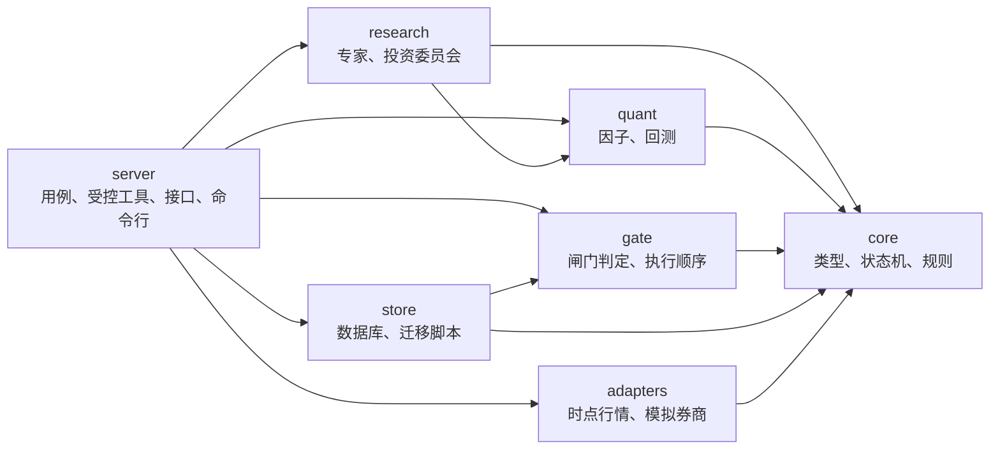
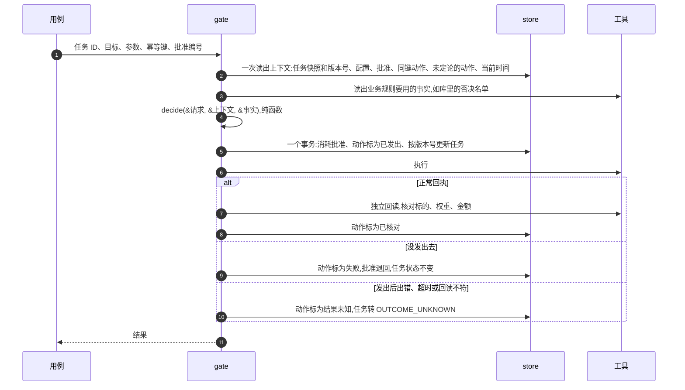

# Rust 后端规划

后端只用 Rust。Gemini 把 trade_ai 迁到了 Rust;之后我按本文合并、改进,并把 Python 骨架里的控制面移植过来,Python 骨架已删除。本文依据 [`diagrams.md`](diagrams.md) 的 11 张图(编号沿用)。第 8 节是改进清单和完成情况,第 10 节是代码量。

目标有三个:低耦合、高内聚、代码少。Rust 有三个常见难点,本文给出统一写法:

- 所有权和生命周期需要换一种思路;
- 复杂的图结构和循环引用写起来别扭;
- 改一点就要重新编译,不利于高频试错。

## 1. 三条总原则

| 原则 | 做法 | 解决的难点 |
|---|---|---|
| 数据库是唯一的真相 | 任务、动作、批准、结论都存在库里;内存里不保留对象之间互相指向的结构 | 循环引用 |
| 纯核心,外壳做副作用 | 业务规则写成纯函数,不碰数据库也不碰网络;读写数据库、调用外部系统只在最外层 | 生命周期、试错速度 |
| 关系用 ID,不用引用 | 任务和动作、动作和批准之间用 ID 关联,需要时查库 | 所有权、循环引用 |

## 2. crate 划分



| crate | 内容 | 对应的图 | 有无 IO |
|---|---|---|---|
| core | ID、金额、日期、任务状态和迁移表、步骤计划、风险分级、合约、错误类型、只读数据接口 | 图 2、4a、8 | 无 |
| quant | 因子打分和否决、时点回测;参数在 `FactorParams` | 图 5 | 无 |
| research | 三个专家、投资委员会、组合构建 | 图 2、5 | 无 |
| gate | 闸门的纯判定 `decide` 和执行顺序 `run`;定义 `Tool` 和 `GateLedger` 两个接口 | 图 1、3a、3b | 无,只定义接口 |
| store | 唯一访问数据库的地方:迁移脚本、按 ID 读写、带版本号的更新、事务;实现 `GateLedger` | 图 3b、4a、4b、8 | 有 |
| adapters | 外部系统:时点行情(读 `fixtures/`,实现 core 的数据接口)、模拟券商、OpenAI 兼容的模型接口 | 图 1、7 | 有 |
| server | 用例(每个阶段一组函数)、模型驱动的执行循环、四个受控工具(两个读、草稿、下单,都实现 `Tool`)、HTTP 接口和事件流、到期处理、命令行 | 图 0、3b、4b、6、7 | 有 |

三条规则:

- 依赖只朝下。core、quant、research、gate 不依赖任何有 IO 的 crate。
- 只有 store 写 SQL,只有 adapters 连外部系统,只有 server 把它们串起来。受控工具放在 server,因为它们既要读库里的否决名单和计划,又要调用券商。
- sqlx、axum、tokio 这些重依赖只出现在 store、server。改业务规则时不用重新编译它们。

合并时的改名:trade-workers 改为 research,trade-broker 改为 adapters,trade-cli 并入 server。

## 3. 所有权和生命周期:六条写法约定

| 约定 | 做法 |
|---|---|
| 领域类型拥有自己的数据 | 用 `String`、`Vec`、newtype;结构体里不存引用,领域代码里不出现生命周期参数 |
| 输入借用,输出新值 | 函数参数用 `&T`,返回拥有所有权的结果;判定函数不修改输入 |
| 关系用 ID | `TaskId`、`ApprovalId`、`IdempotencyKey` 这类 newtype;不用 `Rc`、`RefCell` 或裸指针拼对象图 |
| 共享的只有只读的东西 | 配置、连接池、事件广播放在 `Arc` 里;可变状态只放数据库,不长期放在 `Mutex` 里 |
| 不跨 `.await` 持有借用 | 用例每一步从库里重新读,写回时带版本号;读出来的值在本函数里用完 |
| 错误用枚举 | 至少区分「请求发出前失败」「没发出去」「发出后结果不明」;字符串只在程序入口出现 |

另外一条:先克隆,后优化。小值随便克隆;只有回测这类测得出来的热点,再考虑借用和零拷贝。

实际写下来还有一条:时间是参数。状态迁移 `transition(next, now)` 和闸门的上下文都由调用方给出当前时间,纯函数里不读时钟,测试里可以随意设定。

## 4. 图结构和循环怎么写

| 图里的结构 | Rust 里的写法 |
|---|---|
| 图 4a 状态机,有环(等待和运行来回、结案后重开) | 一个枚举加一张 `match` 迁移表;环只是表里的一行,不存在节点对象 |
| 图 0、图 1 的执行循环(提议、闸门、执行、回读、再提议) | `Harness::advance`:一个有轮数上限的循环,每轮从库里读、做一步、写回;由请求或后台任务驱动,不递归 |
| 图 2 的计划依赖 | `trade-core` 的 `Plan`:每一步带 `depends_on`;`Plan::new` 用拓扑排序排好顺序,步骤重名、依赖不存在、有环都拒绝。步骤是不是做完不存在计划里,按库里的事实算。模板写在任务类型配置里,FRAME 时存第 1 版;有人否决一个可以跳过的步骤,就存去掉这一步的新版本 |
| 图 2 的分派(主 Agent 和 worker) | 任务书和结果都是值;专家只拿到只读视图,彼此不共享可变状态 |
| 图 3b 批准(任务等批准,批准指回任务) | 两张表用 ID 互相指向;「消耗批准」「登记已发出」「更新任务」在同一个数据库事务里完成 |
| 图 8 的一对多、多对一 | 外键加查询;Rust 里没有双向指针 |
| 图 7 的事件流 | tokio 的 broadcast 通道,每个订阅者持有自己的接收端 |

## 5. 一次执行步骤里,数据归谁



写事务之前如果版本号对不上(批准人或别的请求刚改过任务),闸门重新读、重新判断,最多三次;请求发出之后不再重来。闸门不在 `.await` 之间持有任务的可变引用。

`crates/trade-gate/src/lib.rs` 里的样子:

```rust
pub struct GateContext {
    pub task: TaskRecord,                       // 状态、版本号、上限用量、开始运行的时间
    pub config: TaskTypeConfig,
    pub approval: Option<ApprovalRecord>,
    pub existing_intent: Option<ActionIntentRecord>,
    pub unresolved_intent: Option<IdempotencyKey>,
    pub now_epoch_s: i64,
}

pub enum Verdict {
    Proceed(Dispatch),
    NeedsApproval(Dispatch),
    Replay { receipt_id: String, payload_hash: String },
    Limit(String),            // 第 1 道:上限用完,任务转 LIMIT_REACHED 等负责人
    Stop(PreDispatchError),   // 第 1 道:任务被冻结或不在运行,不算拒绝次数
    Deny(PreDispatchError),   // 其余各道:拒绝,原因回给提议方,计一次拒绝
}

pub trait Tool {
    type Args;
    type Facts;                                 // 业务规则要核对的事实
    fn name(&self) -> &str;
    fn min_tier(&self) -> RiskTier;             // 配置只能调高,不能调低
    fn canonical_args(&self, args: &Self::Args) -> Result<String, PreDispatchError>;
    async fn load_facts(&self, task: &TaskRecord, args: &Self::Args) -> Result<Self::Facts, GateError>;
    fn check(&self, args: &Self::Args, task: &TaskRecord, facts: &Self::Facts) -> Result<(), PreDispatchError>;
    async fn execute(&self, ticket: &VerifiedGateTicket, ..) -> Result<String, ExecError>;
    async fn readback(&self, args: &Self::Args, receipt_id: &str) -> Result<(), String>;
}

pub fn decide<T: Tool>(tool: &T, req: &GateRequest<T::Args>, ctx: &GateContext, facts: &T::Facts) -> Verdict;
```

`decide` 按图 3a 的顺序检查:工具在配置里;任务在运行、没有冻结、没有未定论的动作、上限没用完;参数合法;不是 R4、没有注入;放权级别允许;业务规则;同键动作重放或拒绝;需要时请求批准。所有拒绝都在请求批准之前。`execute` 要一张只有闸门能签发的凭证,工具的副作用不可能绕过闸门触发。

### 5.1 模型驱动的执行循环

配置了模型时,`advance` 的每一轮由模型提议一个工具调用(`crates/trade-server/src/agent.rs`),对应图 0 的 ACT 和图 1 的「模型只提议」:

| 工具 | 怎么执行 |
|---|---|
| `research`、`screen`、`read_filings` | 只读,也过闸门(`read_pit_market` R0、`read_pit_filings` R1):只能读合约日期、本任务市场范围内的证券,和写一样登记、回读;公告标为不可信文本 |
| `create_rebalance_draft`(权重由模型定)、`submit_paper_orders` | 过闸门,和固定规则走的是同一个闸门和同样的批准 |
| `finish` | 交给验收,验收只看库里的事实 |

- **模型看到的**:`prompts/agent.md` 里的说明(上限由配置填进去)、任务合约、最近 16 条对话记录,以及每轮从库里现读的状态:用量、草稿、动作、批准、上次验收的缺口。
- **对话记录存在库里**:模型的每一句和得到的每个结果都写进任务时间线(`agent.reply`、`agent.observation`),所以等批准、重启之后都能接着做。
- **批准的是确切内容**:人批准之后,按批准记录里的内容原样发出,不再问模型。
- **上限照样管用**:模型的每一句回复算一轮;回复不是合法提议、提议了不存在的工具,都算一次被拒。轮数、花费、时间或连续被拒用完,任务进入 `LIMIT_REACHED` 等负责人:加了额度就接着做,不管就到期交付已完成的部分。
- **业务规则在执行前检查**:单只、行业、流动性、持仓数的上限在闸门里就检查(`limit_breaches`),验收时用同一个函数再查一遍。模型定的权重不合规,写草稿之前就被拒,原因告诉模型。
- **接口**:任何 OpenAI 兼容的地址都行(Ollama、vLLM、llama.cpp);现在只走 HTTP,要连 HTTPS 的托管服务时给 reqwest 加 TLS 特性。

测试用一个按脚本回答的假模型,跑在真实的 HTTP 接口上(`crates/trade-server/tests/agent.rs`),检查模型被拒后看到的原因、批准后的原样发出、否决下单后的部分交付、乱回答和不收手时的上限。

真模型用 `notebooks/scenarios.py` 测:通过接口跑一个成功案例和十二个对抗案例(人否决、批准过期、违反规则的要求、资料里的提示注入、请求不完整、券商出错、运行超时后负责人加额度或没人管),按系统状态判定,统计被拒、人否决、改正的次数和每个完成任务的成本。同一组场景先在固定规则上跑,再让模型跑,用来回答导图 6 FALSIFY 的问题:更简单的流程够不够用。Colab 笔记本的第 7 节就是这样跑的。

M7 结束时在 Colab 的 L4 上用 qwen3.8:27b 跑了一遍:固定规则和模型都是 13/13,模型一次也没被闸门拒绝。固定规则用了 1 秒,模型用了 237 秒,每个完成任务的全部成本一样(4.26 美元)。这组场景里没有一个需要模型才能做对,所以对这类任务,固定流程就够用。

## 6. 高频试错:改了之后多快能看到结果

| 要反复试的东西 | 放在哪里 | 改了之后 |
|---|---|---|
| 策略参数:因子权重、扣分和否决阈值、委员会权重、分歧度阈值、仓位上限、回测设置;三个专家的权重、满分尺度、关键词和置信度 | `config/strategy.toml` | 不用重新编译,重新运行即可。写错的键名直接报错 |
| 风险分级、上限、放权级别、等待期限 | `config/task_types/*.toml`,启动时写入库 | 不用重新编译;要重启,并升版本号 |
| 演示和测试用的市场数据 | `fixtures/market.json` | 不用重新编译 |
| 状态机、闸门判定 | core 和 gate 里的纯函数 | `cargo test -p trade-core -p trade-gate` 几秒出结果,不需要数据库 |
| 迁移有没有改变行为 | Python 版的基准文件 `crates/trade-server/tests/golden/python-mvp.json` | 每次 `cargo test` 自动比对 |
| 前端联调 | `/v1/dev` 下的载入演示任务、拨快时钟、券商故障 | 不需要真的 Agent |

测试分四层,共 82 个:

| 层 | 测什么 | 怎么测 |
|---|---|---|
| core、gate | 迁移表和图 4a 逐条一致;随机事件序列走不到非法状态;闸门九步的顺序和每一道的拒绝;批准的每种失效;读到旧数据时不会覆盖并发的否决 | 属性测试(proptest);表驱动测试;闸门用内存里的账本,不需要异步运行时 |
| quant、research、adapters | 4 个调仓日的股票池、分数、否决、委员会结论、权重,以及回测指标,都和 Python 版一致;时点规则 | 和基准文件比对,浮点按容差 |
| store | 版本号冲突、批准只能用一次、没发出去的动作退回批准、结果未知时不能取消、单位成本口径、到期查询、外键 | 每个测试一个新的 SQLite 库;设置 `TRADE_TEST_PG_URL` 后每个测试一个新的 PostgreSQL 库(在 Colab 的 PostgreSQL 16 上全部通过) |
| server | 用例端到端:两条否决路径、到期处理、两种券商故障、重启后对账、返工、触上限后加额度或到期交付、篡改的引用;HTTP 接口的身份、错误码、去重、事件流、联调接口;模型驱动的循环:读写都过闸门、被拒后改正、批准后原样发出、触上限 | 真实的用例和模拟券商;axum 在进程内调用;模型是一个按脚本回答的 HTTP 服务 |

## 7. 每张图落在哪里

| 图 | 代码 | 验证 |
|---|---|---|
| 图 0 总体活动图 | `server/src/workflow.rs`:`admit`、`frame`、`advance`、`close`、`confirm_settlement` | `tests/workflow.rs` 的 `full_run_completes_and_a_reopened_task_counts_once` |
| 图 1 职责泳道 | crate 边界本身;`gate::run` 的顺序;`VerifiedGateTicket` | 依赖方向由 Cargo 保证 |
| 图 2 定义阶段 | `Harness::frame` 定合约或提问,并存计划第 1 版;闸门第 5 道拒绝没就绪或已跳过的步骤,固定规则和模型两条路都受它约束;研究阶段专家只拿只读视图 | `ambiguous_request_waits_for_an_answer_then_goes_to_a_person`、`the_plan_orders_the_steps_and_a_refused_step_stays_dropped`、`refused_orders_are_skipped_and_the_draft_delivered_as_partial`;`plan.rs` 的拓扑排序和环检测有属性测试 |
| 图 3a 闸门 | `gate::decide` | `refusals_follow_diagram_3a_in_order` 等 4 个表驱动测试 |
| 图 3b 批准 | store 的批准表和事务;`Harness::decide_approval`(绕开或被否决) | `approval_is_used_once_for_exactly_its_payload`、`a_rejection_after_the_gate_read_wins`、`refused_orders_are_skipped_and_the_draft_delivered_as_partial`、`refusing_a_required_step_declines_the_task` |
| 图 4a 状态机 | `core/src/state.rs` 的迁移表;store 带版本号的更新;触上限也是等待状态,`Harness::grant_budget` 加额度回到运行,`deliver_what_is_done` 和到期处理交付已完成的部分 | `transition_table_matches_diagram_4a_exactly`、`random_walks_keep_diagram_invariants`、`stale_copy_cannot_overwrite_a_newer_write`、`the_owner_grants_more_budget_and_the_task_finishes`、`a_used_up_limit_waits_for_the_owner_then_delivers_what_was_finished`、`a_grant_cannot_buy_more_reworks` |
| 图 4b 恢复 | `Harness::reconcile`、`Harness::recover`(启动时);两个工具按幂等键回读 | `a_request_lost_before_the_broker_is_reconciled_and_sent_once`、`a_lost_reply_after_a_fill_is_reconciled_without_a_second_order`、`a_restart_settles_what_a_crash_left_in_flight` |
| 图 5 场景 | 命令行 `agent`、`research`、`backtest` | `tests/parity.rs` 和 Python 基准逐项比对 |
| 图 6 收尾与度量 | `Harness::verify`(只读库、行情和券商)、交付、验收、到期结案;store 的单位成本 | `a_tampered_citation_fails_verification_and_goes_to_a_person`、`verification_fails_without_any_evidence`、`spend_limit_sees_every_cost_and_unit_economics_counts_ended_tasks_once` |
| 图 7 组件 | crate 划分;`server/src/api.rs` 的接口和事件流 | `tests/api.rs` |
| 图 8 数据模型 | `migrations/0001_schema.sql`;`0002_plans.sql` 存计划的各个版本(PLAN);`0003_budget_grants.sql` 记负责人加的额度 | store 的测试,SQLite 和 PostgreSQL 16 上都跑过 |

## 8. 改进清单和完成情况

### 8.1 迁移收尾(M0,Gemini 完成)

| 编号 | 问题 | 结果 |
|---|---|---|
| A1 | 工作区编译不过:trade-store 还不存在 | 已完成,之后又按 F4 重写 |
| A2 | 因子截尾在浮点误差下 panic | 已完成 |
| A3 | 闸门测试用了 `unsafe`;闸门没有测试 | 已完成,之后闸门按 B1 重写,测试也重写 |
| A4 | 命令行是空的 | 已完成 |

### 8.2 所有权和生命周期

| 编号 | 问题 | 结果 |
|---|---|---|
| B1 | 闸门在 36 处 `.await` 之间一直持有 `&mut TaskRecord`,并发时会用旧状态覆盖新状态 | 已完成。上下文一次读出,`decide` 是纯函数,写库集中到带版本号的事务,冲突就重读 |
| B2 | ID 全是字符串,容易传反 | 已完成:`TaskId`、`ApprovalId`、`IdempotencyKey`,冻结的动作键也是 `IdempotencyKey` |
| B3 | `evaluate_and_execute` 有 11 个参数 | 已完成:`GateRequest`,`run(ledger, tool, &request)` |
| B4 | 执行和回读的错误是字符串 | 已完成:`ExecError::{NotSent, Unknown}`,没发出去的不触发冻结 |
| B5 | 类型状态包装约束不了什么 | 已删除 |

### 8.3 图结构和循环引用

| 编号 | 问题 | 结果 |
|---|---|---|
| C1 | 迁移表和图 4a 有 5 处出入 | 已完成,测试逐条比对 13×13 |
| C2 | 批准被否决时一律转被否决 | 已完成:不可逆的一步(R3)在合约允许时可以绕开,回到运行中、交付已完成的部分;否则 `DECLINED`。过期同样处理 |
| C3 | 计划依赖还没有 | 已完成:`Plan`、`plans` 表(`migrations/0002_plans.sql`)、任务类型里的 `[[plan]]` 模板。原来「下一步做什么」散在 11 处,现在由计划决定;下单被否决、跳过之后,模型再提下单会被闸门拒绝,不会再建批准请求 |
| C4 | 未来一个月的收益会交给专家 | 已完成:快照类型里没有这个字段,回测通过 `get_forward_returns` 单独拿 |

### 8.4 高频试错

| 编号 | 问题 | 结果 |
|---|---|---|
| D1 | 策略参数写死在代码里 | 已完成。因子、委员会、组合、研究范围、回测,以及三个专家的打分规则(24 个数和 29 个关键词,`[specialists.*]`)都在 `config/strategy.toml`。测试核对文件里的专家参数等于 Python 版的默认值 |
| D2 | 风险分级、上限、放权级别写在代码里 | 已完成:`config/task_types/*.toml`,版本不可改。改了要重启,不用重新编译 |
| D3 | 没有演示数据文件 | 已完成:`fixtures/market.json`,从迁移前的程序导出,结果逐项一致 |
| D4 | 没有属性测试和基准比对 | 已完成:proptest 和 Python 基准文件。没用 insta,基准文件已经够用 |

### 8.5 控制面

| 编号 | 问题 | 结果 |
|---|---|---|
| E1 | 等待期限写死在 2099 年,没有到期处理 | 已完成:期限按任务类型配置算;后台每 30 秒处理到期:没回答转人工,没批准按否决,没异议按验收结案,没人接手转给备用负责人,触上限没人管就交付已完成的部分 |
| E2 | 墙上时间上限没人传 | 已完成:任务记着最近一次进入运行的时间,闸门自己算。等人的时间不计入 |
| E3 | 验收、交付、结案、交接、重开、恢复都没有 | 已完成,见第 7 节 |
| E4 | 审计、记分卡、`/v1` 接口和事件流没有 | 已完成,见 [`api.md`](api.md)。还没有 OpenAPI 文件 |
| E5 | 单位成本口径错 | 已完成:只算已结束任务的全部成本,重开后再完成只算一次 |
| E6 | 触上限后只能验收已完成的部分,图 4a 的「负责人加额度,回到运行中」没有 | 已完成:`LIMIT_REACHED` 和其他等待一样有负责人(`escalation_owner_id`)、期限(`limit_ttl_s`,默认 4 小时)和到期动作(`DELIVER`)。负责人加轮数或花费就回到运行,连续被拒清零,时间重新算;不管就到期交付。发起人不能给自己的任务加;返工和重试次数加不了。接口是 `POST /v1/tasks/{id}/limit`,额度记在 `migrations/0003_budget_grants.sql` 加的两列 |

### 8.6 结构和代码量

| 编号 | 问题 | 结果 |
|---|---|---|
| F1 | crate 命名和划分 | 已完成 |
| F2 | 冗余代码 | 已删除:Python 骨架、类型状态包装、写在 Rust 里的演示数据、存储层里的行情查询、旧的哈希函数和重复的架构说明 |
| F3 | 代码量 | 超出估算,见第 10 节 |
| F4 | store 逐列手写读取 | 已完成:`FromRow` 映射,存储层不再依赖 quant 和 research |

### 8.7 做的过程中发现并修好的

- 动作结果未知时,同一任务的**其他**动作原来照样能发出。现在只要有未定论的动作,闸门第 1 道就拦下。
- 下单回读原来只核对笔数和 `FILLED`。现在逐笔核对标的、权重和金额。
- 没发出去的动作原来要重新批准。现在批准退回,重发直接用。
- 记成本原来不更新任务的花费,花费上限形同虚设。现在同一个事务里更新。
- 等人批准的时间原来会算进墙上时间。现在只算运行的时间。
- PostgreSQL 的 `SUM(BIGINT)` 返回 `NUMERIC`,原来的单位成本查询在 PostgreSQL 上会读不出来。现在显式转换。
- 批准后、用掉之前可以撤回;撤回和闸门同时发生时,以撤回为准。
- 闸门写入的辅助函数原来用异步闭包,在 axum 里过不了 `Send` 检查,改成了一个小枚举。

### 8.8 还没做的,和有意留着的

还没做的:

- 图 6 的记忆审核:验收时写入一条经验(`curated_memory`,状态 `pending_review`),还没有审核和复用它的接口。写入的代码留着,下一轮做审核。
- 图 3b 的「在业务系统里批准」:现在只能通过 `/v1/approvals` 批准。
- 图 2 的按难度选模型、用模型当专家:现在一个模型只做主 Agent 的提议,三个专家还是确定性的规则。
- OpenAPI 文件;真实登录和角色;多实例下的对账租约;由后台任务自动推进 `advance`。

有意留着的:

- 闸门的内存账本和它的测试:不需要数据库,几秒出结果,就是第 6 节说的高频试错。
- `hand-back`、`evaluations` 两个接口和放权级别的几个变体:是图 4a 和导图 7 里的概念。
- 数据库里写了、现在还没有读的列,例如交接包的接手人和接手时间:是审计用的。

## 9. 里程碑

| 阶段 | 内容 | 状态 |
|---|---|---|
| M0 | 迁移收尾:A1 到 A4 | Gemini 完成 |
| M1 | core 和 gate:B1 到 B5、C1、C2、C4、D4 | 完成 |
| M2 | store:一个迁移脚本、`FromRow`、批准原子消耗、带版本号更新、行情移出 | 完成。之后在 Colab 的 PostgreSQL 16 上跑通过 |
| M3 | 用例:E1 到 E3、E5,配置外置 D1 到 D3,和 Python 基准比对 | 完成。C3 在 M7 完成 |
| M4 | HTTP 接口和事件流:E4 | 完成 |
| M5 | 清理和文档:F1 到 F3 | 完成,PR #1 |
| M6 | 接入模型:模型驱动执行循环,写操作照样过闸门;业务上限移到执行前检查;Colab 笔记本 | 完成,在 `agent-model` 分支。专家还是规则 |
| M7 | 图 2 的步骤计划(C3)、专家规则进配置(D1 收尾)、图 4a 的加额度(E6);清理:删掉 `demo`、`bench` 命令,接口和命令行只输出稳定的 JSON,两条执行路径共用请求构造和发送;失败场景加到 13 个 | 完成,在 `agent-model` 分支。Colab 上 82 个测试、四次模型任务、13 个场景都通过,PostgreSQL 上三个迁移都跑过 |

## 10. 代码量

非测试代码,不计空行和注释,M7 结束时:

| crate | 估算 | 实际 | 测试 |
|---|---|---|---|
| core | 1,000 | 1,421 | 252 |
| quant | 750 | 742 | 84 |
| research | 600 | 560 | 112 |
| gate | 550 | 462 | 923 |
| store | 950,另有约 250 行 SQL | 1,422,另有 148 行 SQL | 518 |
| adapters | 300 | 434 | 133 |
| server | 1,350 | 3,256 | 1,724 |
| 合计 | 约 5,500 | 8,297 | 3,746 |

M7 开始时是 8,102 行:

- 清理减了 193 行:删掉 `demo`、`bench` 两个命令和没人用的类型,两条执行路径共用请求构造和发送,存储层合并重复的写法。
- 专家规则进配置加了 46 行,步骤计划加了 254 行(其中 `plan.rs` 122 行),加额度加了 142 行。
- 最后去掉建任务时的两个中间结构,两个「等某人决定」的接口共用一段检查,又减了 54 行。

结果比开始时多 195 行(2.4%),没有做到计划里「不超过开始时」的目标,多出来的都是新功能。更早的数字:M5 结束时 7,244 行,M6 接入模型后 7,989 行。超出最初估算的部分主要在 server:HTTP 接口、到期处理和对账、模型驱动的执行循环,估算时都没算进去。

能再减的地方:

- 枚举和文字代码之间的对照(`as_str`、`from_db_str`)有十来处,写成一个宏能省四五十行,但读起来不如现在直接,先不改。
- 存储层新建和更新任务时各写了一遍完整的列清单,可以合并。

都不影响行为。
