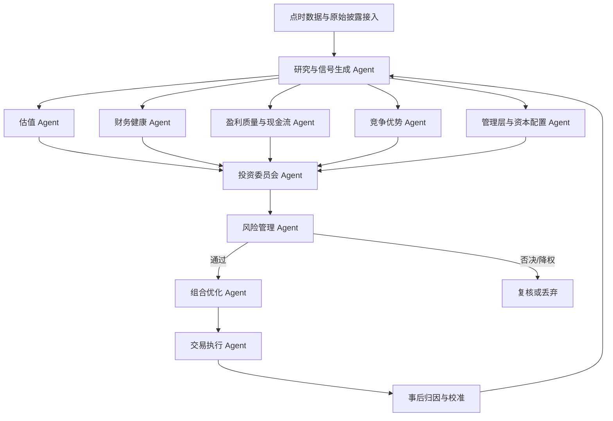

# 用于构建多智能体价值投资系统的思维框架与技能设计

## 执行摘要

这套体系的核心，不是把“价值投资”简单翻译成低市盈率或低市净率筛选器，而是把它拆成一组可以被数据验证、被角色分工、被回测淘汰的判断模块：先判断企业的内在价值与经营质量，再判断市场价格是否出现了足够大的偏离，最后把财务失真、融资脆弱性、流动性和宏观暴露纳入风险约束。学术上，价值、盈利能力、保守投资、财务健康和盈余质量都分别有独立证据支撑；工程上，真正决定系统是否可信的，是是否使用点时数据、是否保留退市样本、是否在会计口径与行业差异上做了标准化处理。citeturn16view1turn0search2turn0search11turn2search4turn27search2turn16view6turn17view0turn18view0

如果把这套逻辑做成 multi-agent 系统，最合理的做法不是“一个大而全的选股 agent”，而是把投资委员会真正会分工讨论的问题拆出来：估值 agent 负责“便宜不便宜”，财务健康 agent 负责“会不会先死”，盈利质量与现金流 agent 负责“利润是真的假的”，竞争优势 agent 负责“高回报率是否可持续”，管理层与资本配置 agent 负责“赚到的钱是否被正确使用”，风险管理 agent 负责“即使判断正确会不会因为拥挤、流动性或宏观波动输掉”，组合优化 agent 负责“怎样把好想法变成可部署仓位”，执行 agent 负责“怎样把模型收益尽量少地丢在冲击成本里”。多 agent 架构的价值在于可解释的分工、显式的交互协议，以及可以按历史表现对每个 agent 的置信度做持续校准。citeturn16view8turn10search1turn10search2

从实现角度看，本报告建议把价值投资的“收益驱动”与“风险约束”分开。收益驱动主要由估值、质量、现金流、财务健康、成长和资本配置构成；风险约束则由财务困境、操纵风险、流动性、行业/宏观集中度和情绪拥挤度构成。默认起始模板建议采用“复合估值 + 质量/盈利能力 + 财务健康 + 盈余质量”主框架，把情绪与价格动量只当作辅助过滤器，而不是替代价值判断本身。这么做的原因很简单：单一低估值信号容易掉入 value trap，而价值与质量、保守投资、低操纵风险的结合，在实证文献里更稳健。citeturn24search20turn16view1turn0search2turn2search4turn27search0turn12search0

最后，任何这类系统都必须接受两类检验。第一类是投资检验：年化收益、波动、夏普、最大回撤、信息比率、胜率、换手、IC、ICIR、分组单调性。第二类是工程检验：数据覆盖率、缺失率、点时一致性、退市处理、重述处理、交易成本敏感性、容量与流动性。没有第二类检验，第一类业绩往往不可信。CRSP 的 active/inactive 样本与 survivor-bias-free 历史、Compustat 与 Bloomberg 的 point-in-time 设计、SEC 的 EDGAR/XBRL 接口，正是为了解决这些问题。citeturn16view6turn17view0turn18view0turn16view3turn20search15

## 文献基础与参考优先级

下面的优先级，不是“哪里数据最多”，而是“哪里最适合建立可追溯、可复核、可回测的价值投资系统”。

| 优先级 | 来源类型 | 适用范围 | 代表来源 |
|---|---|---|---|
| 最高 | 公司原始披露与监管接口 | 做点时财务、注释、治理、内部人交易、公告事件抽取时必须优先；用于校验商业数据库。 | 美股优先用 SEC EDGAR API 与公开 filings，接口可直接取 company submissions 与 extracted XBRL，且 JSON 会在日内更新；中国优先用巨潮资讯、上交所/深交所定期报告与公告原文。citeturn16view3turn20search15turn6search2turn6search11turn22search4turn22search11 |
| 很高 | 权威标准化数据库 | 做大样本横截面、复权价格、退市、会计标准化、链接主键和回测。 | WRDS 聚合 600+ 数据库、60+ 供应商；CRSP 提供 32,000+ active/inactive U.S. securities 的 survivor-bias-free 历史；Compustat 提供 standardized、historical、point-in-time 数据；Bloomberg 也提供 corporate-action-adjusted 的 point-in-time company financials/pricing。citeturn17view1turn16view6turn17view0turn18view0 |
| 很高 | 中国本地商业数据库 | A 股横截面、公告、财务、治理、宏观行业、分析师预期等。 | Wind 提供股票、债券、基金、外汇等全品类金融数据与终端分析；CSMAR 面向中国股票市场和上市公司财务/治理研究。citeturn20search1turn20search5turn20search11 |
| 高 | 学术基准因子与可复现实证框架 | 做 alpha attribution、benchmark neutrality、风格暴露检验。 | Ken French Data Library 提供 3 因子、5 因子及动量等基准；AQR 提供 QMJ、Value and Momentum Everywhere 等研究型数据集。citeturn16view0turn16view1turn1search15turn27search0turn11search13 |
| 高 | 经典书籍与实证论文 | 确立“为什么这些指标值得看”。 | 经典起点建议按作者索引：Graham、Dodd、Fama、French、Piotroski、Sloan、Novy-Marx、Asness、Frazzini、Pedersen、Altman、Beneish、Baker、Wurgler。核心实证包括价值因子、五因子、F-score、应计异象、gross profitability、QMJ、情绪与过度反应等。citeturn0search15turn8search0turn0search2turn0search11turn2search4turn27search2turn9search0turn9search7 |

如果只允许建立一条最小可行研究链路，建议按这个顺序做：原始财报/XBRL与公告抓取，随后接标准化财务与价格数据库，再接学术因子基准，最后才做文本增强与多 agent 编排。原因是价值投资系统最怕的不是模型不够复杂，而是把“后来才知道的数据”错当成“当时可见的数据”。Compustat 和 Bloomberg 都把 point-in-time 当作核心卖点，CRSP 明确强调 survivor-bias-free 历史，EDGAR 则直接提供 filings 与 extracted XBRL；这几类能力是回测可信度的地基。citeturn17view0turn18view0turn16view6turn16view3

## 核心判断维度与量化指标

下表把价值投资者常见的核心判断拆成十个维度。需要先说明两点。第一，只有少数阈值在文献里有较固定 cut-off，例如 Piotroski、Altman、Beneish；多数阈值只能作为工程启始值，必须按市场、行业、会计口径与流动性再校准。第二，很多指标本质上应该“行业中性、国家中性、点时化”以后再比较，否则容易把行业差异误当 alpha。citeturn26search3turn28search4turn15search2turn25view0turn17view0turn18view0

| 维度 | 定义 | 可量化指标与数据源 | 阈值/信号示例 | 优点 | 常见陷阱 |
|---|---|---|---|---|---|
| 估值方法 | 判断当前价格相对内在价值或同业相对价值是否足够便宜。 | 复合估值优先：\(B/M\)、\(E/P\)、\(EBIT/EV\)、\(FCF/EV\)、行业相对 PE/EV-EBITDA、DCF。Fama-French 的 HML 以 B/M 组合构造；AQR 的复合价值框架同时使用 book-to-price、earnings-to-price、forecast earnings-to-price、sales-to-EV、cash-flow-to-EV；Damodaran 明确提醒 PE 和 EV/EBITDA 很容易被增长、风险、负盈利和口径差异误用。数据来自 CRSP/Compustat、Bloomberg、Wind/CSMAR、EDGAR/CNINFO。 citeturn16view0turn24search20turn25view0turn25view3turn25view1turn16view3turn6search2 | 行业中性复合估值分位前 20%；或 DCF 安全边际大于 25%。对高无形资产行业，降低 P/B 权重、提高 EV/Sales 或 FCF/EV 权重。 | 直接对应“安全边际”，解释力最强。 | 负盈利时 PE 失效；P/B 会低估无形资产密集企业；DCF 最怕现金流与折现率错配。 |
| 财务健康 | 判断企业在价值兑现之前，是否会先因杠杆、短债或再融资压力“出局”。 | \(NetDebt/EBITDA\)、Interest Coverage \(=EBIT/Interest\)、Current Ratio、Debt/Assets、Altman Z-score。Altman 原始 Z-score 使用 \(WC/TA\)、\(RE/TA\)、\(EBIT/TA\)、\(MVE/TL\)、\(Sales/TA\)；原始模型常用分区为 \(Z>2.99\) 安全、\(1.8\sim2.99\) 灰区、\(<1.8\) 困境。 citeturn28search4turn3search18 | 启始值：\(NetDebt/EBITDA<2\)，Interest Coverage \(>4\)，Current Ratio \(>1.2\)；若 \(Z<1.8\) 触发硬性复核或直接 veto。 | 能显著减少“便宜但先暴雷”的样本。 | 金融、保险、券商、REIT 的口径不同；周期顶部时覆盖倍数会虚高。 |
| 盈利质量 | 判断利润是否更多来自可持续经营，而不是应计、会计选择或操纵。 | Sloan 应计指标：\((NI-CFO)/AvgTA\)；\(CFO>NI\) 通常优于 \(NI \gg CFO\)；Beneish M-score 可做操纵预警。Sloan 发现市场往往对 accrual 与 cash-flow 的持续性区分不充分；Kelley 的 Beneish 工具按八个比率计算 M-score，并以 \(-1.78\) 为常见 cut-off。 citeturn0search11turn15search0turn15search2 | 启始值：应计率越低越好，最好位于样本后 30%；\(CFO/NI>1\) 为正信号；\(M<-1.78\) 较干净，\(M>-1.78\) 进入高风险复核。 | 对识别 value trap、财务粉饰很有效。 | 季节性营运资金、一次性库存波动、并购后会计重分类会制造假警报。 |
| 现金流 | 判断“利润”能否真实转成现金，并最终形成自由现金流。 | \(CFO/NI\)、\(FCF=CFO-Capex\)、\(FCF/EV\)、\(FCF\ Margin=FCF/Sales\)、Cash Conversion。原始财务与现金流表可从 EDGAR/XBRL、巨潮/交易所定期报告获取；Compustat 与 Bloomberg 提供标准化与 point-in-time 版本。 citeturn16view3turn20search15turn17view0turn18view0turn6search11 | 启始值：最近 5 年中至少 3 年 FCF 为正；\(FCF/EV\) 处于行业前 30%；\(CFO/NI>1\)。 | 直接连接估值兑现能力与股东回报来源。 | 重资本扩张期的优质公司会被短期 FCF 误伤；存货压缩或应付拉长会暂时美化现金流。 |
| 成长性 | 判断低估值是不是“坏生意没有成长”，还是“被低定价的有质量成长”。 | 3 年/5 年 Revenue CAGR、Gross Profit Growth、EBIT Growth、Operating Profitability；Fama-French 五因子中的 RMW 与 CMA 分别对应盈利能力与保守投资；Novy-Marx 发现 gross profits-to-assets 对收益的解释力接近 B/M，且对大型、流动性好股票也有效。激进资产扩张则与未来收益偏弱有关。 citeturn16view1turn8search0turn2search4turn12search0 | 启始值：销售/毛利 3 年 CAGR 高于行业中位数，同时资产增长率不处于最高一档；“高增长 + 低盈利”不给高分。 | 能区分“廉价衰退股”和“廉价成长股”。 | 外延并购能制造表面成长；只看收入不看利润与资本消耗，会高估价值。 |

| 维度 | 定义 | 可量化指标与数据源 | 阈值/信号示例 | 优点 | 常见陷阱 |
|---|---|---|---|---|---|
| 竞争优势 | 判断高回报率是否来自可持续护城河，而非景气上行或会计噪声。 | Sustained \(ROIC-WACC\)、Gross Profit/Assets、5 年 Gross Margin 与 Operating Margin 稳定性、分部利润率/市场份额稳定性。Damodaran 强调估值中最关键的数字不是贴一个多高的 WACC，而是你给企业认定了多高、能持续多久的 return on capital；Novy-Marx 与 QMJ 文献都把盈利能力与质量视作高质量股票的重要基础。 citeturn25view2turn2search4turn27search0turn27search16 | 启始值：5 年平均 \(ROIC-WACC>2\%\)；毛利率标准差低于行业中位数；Gross Profit/Assets 进入前 30%。 | 比单期估值更接近商业本质。 | 周期顶部的“伪护城河”很多；无形资产未资本化会扭曲投入资本口径。 |
| 管理层 | 判断管理层是否与股东同向，是否有兑现承诺与克制激励的记录。 | 内部人持股与净买入、股权激励稀释率、薪酬与 ROIC/TSR 的对齐度、对外承诺与实际资本回报的一致性。美股可直接用 DEF 14A、Forms 3/4/5 与 SEC insider datasets；A 股则以年报、公告、股权激励计划和巨潮/交易所披露为主。 citeturn5search0turn17view6turn17view5turn6search2turn6search11 | 启始值：过去 12 个月内部人净买入为正；SBC/总股本稀释小于 2%/年；股权激励指标包含 ROIC/FCF 而非只看收入。 | 能把“会做生意”与“会替股东做事”区分开。 | 内部人增持不是充分条件；双重股权或国企治理结构会让指标解释力下降。 |
| 资本配置 | 判断赚到的钱是否被高回报再投资、便宜回购或合理分红，而不是被浪费。 | Reinvestment Rate、Incremental ROIC、Buyback Yield、Dividend Yield、Net Share Issuance、Goodwill/Assets 变化、Asset Growth。股本增发与净股票发行在长期横截面上通常是负面信号；激进资产扩张也常伴随较弱的后续收益。 citeturn12search19turn12search5turn12search0turn25view2 | 启始值：回购只在公司同时“便宜 + 高现金流”时加分；股本不应持续稀释；若 goodwill/资产突然跳升，需要人工复核。 | 非常贴近长期复利来源。 | 机械奖励回购会误伤高增长再投资公司；债务融资回购会把风险抬高。 |
| 宏观/行业风险 | 判断个股 alpha 是否会被利率、汇率、商品、政策或行业集中风险吞噬。 | 行业/国家中性暴露、历史 beta、情景损失、客户集中度、库存/销售、Amihud illiquidity、成交额占 ADV。Amihud 的 ILLIQ 常写作一段时间内日度 \(|r|/\$Volume\) 的均值，是广泛使用的流动性/价格冲击代理。 citeturn9search2turn9search8 | 启始值：组合层面限制单行业/单国家/单因子暴露；单票参与率不超过 ADV 预算；高 ILLIQ 名称只允许小权重。 | 让“研究正确但仓位死掉”的概率下降。 | 风险模型常滞后于 regime shift；历史相关性在危机中会失真。 |
| 情绪与市场定价偏差 | 判断低估值是否只是“没人看”，还是已经演化成拥挤、错误定价或过度反应。 | 行业内 value spread、换手率/拥挤度、分析师预期偏差、过度反应后反转、12-1 动量作为辅助 tie-breaker、市场情绪状态变量。Baker-Wurgler 发现情绪对估值主观、难套利证券影响更大；De Bondt-Thaler 记录了市场过度反应；Asness 等则表明价值与动量在多个市场普遍存在且通常负相关，适合作为互补过滤器而非互相替代。 citeturn9search0turn9search7turn11search1turn24search5 | 启始值：便宜但伴随极端负面中期价格趋势时先减分而不是立刻买入；若估值很便宜且动量由极差回升到中性，通常优于“越跌越买”。 | 有助于避免接飞刀，并提高入场时机质量。 | 情绪可以长期维持；如果把情绪作为主策略，容易偏离价值投资初衷。 |

有两个经验性结论值得明确写进系统规则。第一，低估值本身更像“候选池生成器”，不是最终买入指令；高 F-score、低应计、较高 gross profitability、较保守投资，会把价值池里的胜率明显抬高。第二，竞争优势、管理层和资本配置这三类维度，量化代理变量永远不完美，所以更适合由“结构化分数 + 文本证据 + 规则复核”共同决定，而不是纯靠单一财务比率硬裁决。citeturn0search2turn0search11turn2search4turn27search0

## 信号集、打分与组合构建

一套可执行的信号体系，建议分成“主 alpha 桶”和“风控覆盖层”两层。主 alpha 桶负责排序，风控覆盖层负责 veto、降权和仓位上限。价值投资系统如果直接把宏观风险、流动性和情绪与基本面同权平均，通常会把“长期有效的慢变量”与“短期扰动的快变量”混在一起，结果既削弱了价值逻辑，也让模型更难解释。相反，把估值、质量、健康、现金流、成长作为主排序，把困境、操纵、拥挤、流动性当作覆盖层，通常更贴近投资委员会的真实决策流程。citeturn16view1turn0search2turn0search11turn2search4turn27search2

| 因子桶 | 代表信号 | 标准化建议 | 默认权重 | 说明 |
|---|---|---|---|---|
| 估值 | \(B/M\)、\(E/P\)、\(EBIT/EV\)、\(FCF/EV\)、行业相对倍数 | 按国家-行业-日期横截面分位化，再映射到 \([-1,1]\) 或正态 z 分数 | 0.30 | 核心候选池；若某子指标无效，按可用指标重归一 |
| 质量/盈利能力 | Gross Profit/Assets、ROIC、Operating Margin、RMW 代理、F-score | 建议做行业中性；对重资产与轻资产行业分别比较 | 0.20 | 把“便宜”与“好企业”结合 |
| 财务健康 | Net Debt/EBITDA、Interest Coverage、Current Ratio、Altman Z | 对极端值 winsorize；金融股单独口径 | 0.15 | 同时可作为 veto 层输入 |
| 盈利质量 | Accruals、\(CFO/NI\)、Beneish、一次性损益占比 | 优先用点时财务；年度与TTM并行 | 0.10 | 直接过滤 value trap |
| 现金流 | FCF/EV、FCF Margin、Cash Conversion | 对资本开支周期做滚动平均 | 0.10 | 兼顾质量与估值兑现 |
| 成长与保守投资 | 3y sales/gross profit CAGR、资产增长率反向、CMA 代理 | 成长信号与资产扩张应联动处理 | 0.10 | 追求“有质量的成长” |
| 管理层与资本配置 | 内部人净买入、净股本发行反向、Buyback Yield、Incremental ROIC | 低频更新，适合季度刷新 | 0.05 | 更适合做中长期差异化 |
| 情绪/价格行为 | 12-1 动量、过度反应反转、value spread、拥挤度 | 只做 tie-breaker 或降权，不做主驱动 | 0.05 | 用来避免接飞刀与拥挤挤兑 |

默认总分可以写成：

\[
B_i=\sum_k w_k F_{i,k},
\qquad
S_i = B_i-\lambda_1 D_i-\lambda_2 M_i-\lambda_3 L_i,
\]

其中 \(F_{i,k}\) 是第 \(k\) 个主 alpha 桶得分，\(D_i\) 是困境/融资脆弱性惩罚，\(M_i\) 是操纵/盈余质量惩罚，\(L_i\) 是流动性与拥挤惩罚。若出现硬 veto，例如 Altman 困境、Beneish 高风险、持续负 CFO 且净利润为正、极端低流动性，则直接不进入候选池。这样做的好处，是把“看多逻辑”和“排除逻辑”拆开，减少分数互相抵消造成的错配。相关主 alpha 桶的理论基础主要来自 Fama-French 的价值/盈利/投资框架、Piotroski、Sloan、Novy-Marx 和 QMJ。citeturn16view1turn0search2turn0search11turn2search4turn27search0

标准化上，建议统一采用“分组 winsorize + 横截面分位化 + 行业/国家中性化”的流程，而不是直接用全球原始比率排序。理由很实际：PE、EV/EBITDA、毛利率、资本周转这些指标天然带有行业结构差异；国际数据还会叠加 GAAP/IFRS/中国会计准则差异。首先按国家和行业做分组，再把原始值映射成分位，可以让多市场、多行业的排序更可比。若目标是“纯价值风格”而不是“顺便带一堆小盘暴露”，还应对 size 做显式中性化，避免估值分高其实只是市值更小。citeturn25view0turn16view1turn1search5

权重设定建议分三层推进。起步阶段用固定权重，因为最可解释、最稳。第二阶段再用历史 rank IC、ICIR 或 decile spread 做滚动更新，但必须收缩到长期均值，避免过拟合。第三阶段才考虑贝叶斯收缩或带约束的 mean-variance/Black-Litterman，把主观权重与历史信息融合。对价值系统来说，最危险的不是“权重不够聪明”，而是“权重过于聪明”，以至于把一个慢因子体系做成了短样本噪声拟合器。价值 premium 本身就有很长的低迷子区间，Fama 与 French 也明确指出，短到中等长度样本很难稳定辨识其期望溢价是否改变，因此权重更新必须慢、必须有收缩。citeturn24search0turn24search19

组合构建上，建议同时跑两套账。第一套是 long-short 分位组合，用来检验因子纯度，例如多头 top decile、空头 bottom decile，观察分层单调性、spread t-stat 和风格暴露。第二套是可部署 long-only 组合，用于真实投资评估，例如从无 veto 的候选池中选 top 50–100 只，按等权或逆波动加权，设置单票、行业、国家和流动性上限。再平衡频率，基础推荐为“月度交易、季度刷新低频基本面、日度监控风险与执行”，并配 20%–30% 的持仓缓冲带，减少因为小分数波动造成的高换手。若需要提高入场质量，可用中期动量作 tie-breaker；Asness 等发现价值与动量在多市场中具有普遍性且通常负相关，这使它们很适合在组合层面互补。citeturn11search1turn11search13

## 回测与验证方案

回测必须以点时数据和生存偏差控制为前提。美股优先用 CRSP 价格/退市与 Compustat 基本面，经 CCM 链接；CRSP 官方明确强调其 active/inactive securities 覆盖和 survivor-bias-free 历史，Compustat与 Bloomberg 则都把 point-in-time 作为避免 look-ahead bias 的核心卖点。原始披露层面，则用 EDGAR company submissions、XBRL 和 filing 全文复核会计项目、脚注、治理和内部人交易。A 股则建议以 Wind/CSMAR 做历史面板，用巨潮、上交所、深交所定期报告与公告原文做核验。citeturn16view6turn17view0turn18view0turn16view3turn20search15turn20search11turn20search1turn6search2turn6search11

| 验证层级 | 核心方法 | 主要指标 | 判定标准 |
|---|---|---|---|
| 单信号层 | 按月/按季计算 next-period rank IC、hit rate、coverage、missingness | Rank IC、ICIR、胜率、分组单调性 | 方向稳定、单调性可靠、覆盖率高于最低阈值 |
| 横截面层 | 分位排序、Fama-MacBeth 回归、行业/国家中性回归 | 因子系数、t 值、边际解释力 | 新信号在控制经典因子后仍有增量 |
| 组合层 | long-short 与 long-only 双轨评估 | 年化收益、波动、夏普、Sortino、最大回撤、Calmar、信息比率、月度胜率、换手 | long-short 用于纯度；long-only 用于可部署性 |
| 基准层 | 对比市场、行业中性基准与 FF5+Mom 风格暴露 | Alpha、Beta、风格暴露、跟踪误差 | 不能只靠 size 或行业偏离赚钱 |
| 实施层 | 加入冲击成本、参与率、延迟成交、涨跌停/停牌处理 | 实施收益、implementation shortfall、容量 | 模型 alpha 不能被成本完全吃掉 |
| 稳健性层 | 子区间、牛熊、市值组、行业组、危机期、重述样本重跑 | 子样本稳定性、尾部风险 | 不要求每段都赢，但不能只在单一 regime 有效 |

按用户要求，默认给两组历史窗口。第一组是 2000–2023，用于覆盖互联网泡沫后期、全球金融危机、欧债危机、疫情流动性冲击与 2022 利率冲击。第二组是 2010–2023，用于更接近现代市场结构与更完整的高频财报环境。更稳妥的验证方式，是把 2000–2011 作为模型冻结前样本、2012–2023 作为 out-of-sample；再做 rolling 或 expanding walk-forward，检验参数是否真能迁移。citeturn24search0turn24search19

交易成本与流动性约束必须前置进回测，而不是“先算漂亮收益，再事后打折”。起始模板建议：美股 one-way 全成本先假设 10–20 bps，大盘流动性好的票参与率不超过 ADV 的 10%；A 股 one-way 全成本先假设 20–40 bps，参与率不超过 ADV 的 5%，并提高持仓缓冲带。这里的成本数值不是监管真值，而是工程默认值，目的是防止系统在没有执行约束时偏向最便宜但最难成交的股票。真正部署前，应由执行 agent 用历史盘口、成交量曲线和实现短缺做二次校准。Bloomberg Terminal 和 Enterprise Data 产品都把 execution analytics、portfolio analytics、research data 作为一体化能力的一部分，正说明“研究—组合—执行”本就不该切开做。citeturn18view1turn18view0

最需要警惕的限制有六类。其一，幸存者偏差与退市收益缺失；其二，look-ahead bias 与财报可见时点处理错误；其三，会计重述和脚注信息滞后；其四，行业可比性差；其五，交易成本和流动性容量被低估；其六，多重检验与参数挖掘。除此之外，价值因子本身也存在长时间低迷区间，因此系统不能只靠最近一个子区间的表现决定生死。Fama 与 French 关于价值 premium 的新证据，恰好提醒了这一点：后半样本的平均 value premium 更低，但月度波动太高，以至于仅凭短样本很难断言期望溢价已经消失。citeturn16view6turn17view0turn18view0turn24search0turn24search19

## 多智能体系统设计与交互规则

把价值投资逻辑转成 multi-agent 系统时，关键不是“多几个 agent”，而是确保每个 agent 有独立职责、独立证据、统一消息协议和可回测的历史绩效。AutoGen 强调多 agent 可通过可编程对话模式、工具调用和人机混合协作完成复杂任务；CAMEL 强调角色扮演与任务分工；LLM multi-agent survey 则指出角色设计、通信、记忆、反馈与评估是系统成败的关键。把这些原则映射到投资研究，最好采用“专业委员制”而不是“全能分析师制”。citeturn16view8turn10search1turn10search2



| Agent | 核心技能与职责 | 主要输入 | 主要输出 | 决策规则 | 主要交互 |
|---|---|---|---|---|---|
| 研究与信号生成 Agent | 抓取财报、公告、XBRL、价格与行业数据；做字段映射、点时对齐、衍生因子计算 | EDGAR/XBRL、CRSP/Compustat、Bloomberg、Wind/CSMAR、巨潮/交易所公告 citeturn16view3turn16view6turn17view0turn18view0turn20search11turn6search2 | 干净的 feature packet；缺失率报告；可追溯证据 | 不做投资判断，只负责数据真实性、完整性与版本控制 | 给所有下游 agent 提供统一 schema |
| 估值 Agent | 复合估值、行业相对估值、DCF 安全边际 | 价格、市值、债务、现金、财务报表、行业组 | valuation_score、有效估值指标数、估值解释 | 至少两个有效估值子指标才能给高置信度；若全是失效 P/E 或失真 P/B，置信度下降 | 接受风险 agent 的行业中性约束 |
| 财务健康 Agent | 杠杆、短债、再融资与困境识别 | 资产负债表、利息费用、现金流表、价格/市值 | health_score、distress_flag、hard_veto | 若困境分数过高或流动性过低，可直接 veto | 否决权高于估值 agent |
| 盈利质量与现金流 Agent | 应计、操纵、现金转化、自由现金流 | 利润表、现金流表、两年或多期财务 | quality_score、manipulation_flag、cashflow_score | Beneish、极端应计、长期 CFO 弱于 NI 时可降权或 veto | 与估值 agent 共同识别 value trap |
| 竞争优势 Agent | 回报率持续性、利润率稳定性、分部与行业地位 | 多年 ROIC、毛利率、分部数据、行业数据 | moat_score、persistence_confidence | 只有当高回报率持续且波动可控时才给高分 | 会挑战“周期顶部假护城河” |
| 管理层与资本配置 Agent | 激励对齐、内部人交易、稀释、回购/分红、并购质量 | DEF 14A、Forms 3/4/5、年报、股本与 goodwill 变化 citeturn5search0turn17view6turn17view5turn6search2 | management_score、allocation_score、dilution_flag | 稀释恶化、价值毁灭式并购、债务回购可大幅减分 | 与竞争优势 agent 共评长期复利能力 |
| 风险管理 Agent | 因子暴露、流动性、拥挤、情景损失、集中度 | 全部分数、历史波动、相关性、成交量、行业/国家暴露 | risk_penalty、hard_veto、position_limits | 风险是覆盖层，不负责 alpha 排名，但拥有 veto/限额权 | 位于投资委员会之后、组合优化之前 |
| 组合优化 Agent | 把候选股票变成满足约束的权重 | 最终分数、风险限额、流动性约束、 benchmark | target_weights、换手、预期跟踪误差 | 优先最大化分数/单位风险，限制行业、国家、单票与 ADV 约束 | 接收风险 agent 的硬限制 |
| 交易执行 Agent | 把目标权重变成现实成交 | 目标仓位、成交量曲线、成本模型、交易规则 | order_schedule、预计冲击成本、执行偏差 | 低流动性票分批 TWAP/VWAP；实现短缺超预算则反馈 | 把实施结果回传给校准模块 |
| 投资委员会 Agent | 统一聚合、组织争论、记录裁决、升级人工复核 | 各 agent 分数、置信度、证据 | final_score、decision_log、review_queue | 处理冲突与升级；不新增原始事实，只做裁决 | 位于所有研究 agent 上方 |

建议所有 agent 用统一消息协议，至少包含这些字段：

```json
{
  "ticker": "000001.SZ",
  "as_of_date": "2023-12-31",
  "agent": "financial_health",
  "score": 68,
  "confidence": 0.83,
  "hard_veto": false,
  "evidence": ["NetDebt/EBITDA=1.4", "InterestCoverage=6.2", "ZScore=3.1"],
  "missingness": 0.05,
  "stale_data": false,
  "assumptions": ["annual_report_lag=120d"]
}
```

冲突解决机制建议采用“硬 veto 优先、软分歧加权平均、极端分歧升级复核”的三段式规则。形式化地，可以写成

\[
\bar S_i=\frac{\sum_j w_j c_{ij} s_{ij}}{\sum_j w_j c_{ij}},\qquad
Disp_i=\sqrt{\frac{\sum_j w_j c_{ij}(s_{ij}-\bar S_i)^2}{\sum_j w_j c_{ij}}}.
\]

如果财务健康 agent 或盈利质量 agent 给出 hard veto，则直接拒绝；否则用权重 \(w_j\) 与置信度 \(c_{ij}\) 做加权平均；如果 \(Disp_i\) 很高且股票进入买入区，则升级到人工或慢速复核流程。这里的置信度不应由 agent 自报，而应由历史校准决定，例如过去 24–36 个月该 agent 的 rank IC、命中率、veto 精确率与 Brier score。这样，多 agent 系统才不会沦为“多个会说话的随机数发生器”。citeturn16view8turn10search2

## 起始模板、数据需求与示例伪代码

下面给一套可直接启动的模板。它不是最优解，但足够把研究与工程同时跑起来。

| 项目 | 美股/全球模板 | 中国 A 股模板 |
|---|---|---|
| 样本窗口 | 默认同时跑 2000–2023 与 2010–2023 | 默认同时跑 2000–2023 与 2010–2023 |
| 证券池 | 美股：NYSE/AMEX/NASDAQ 普通股；全球：发达市场大中盘，按国家-行业做中性化 | A 股主板/创业板/科创板；建议剔除 ST/*ST、新上市极短样本、极端低流动性 |
| 核心数据 | CRSP + Compustat + CCM；或 Bloomberg point-in-time；原始复核用 EDGAR/XBRL | Wind 或 CSMAR；原始复核用巨潮、上交所/深交所定期报告与公告 |
| 基准与归因 | Russell 3000 / MSCI World；风格归因参考 FF3/FF5/Mom | 中证 800 / 中证全指；风格归因可做市场、规模、价值、盈利质量代理 |
| 会计滞后默认值 | 年报 120 天、季报 45 天 | 年报 120 天、中报 60 天、季报 30–45 天 |
| 再平衡 | 月度；低频基本面季度刷新；20% 持仓缓冲带 | 月度或每 20 个交易日；30% 缓冲带更稳妥 |
| 组合规模 | long-only 50–100 只；研究型 long-short 可用 top/bottom decile | long-only 50–80 只；研究型 long-short 用于纯度验证 |
| 权重 | 等权起步，之后可升级到逆波动或优化器 | 等权或逆波动，单票上限更严格 |
| 流动性约束 | 单票参与率 \(\le 10\%\) ADV | 单票参与率 \(\le 5\%\) ADV |
| 成本假设 | one-way 10–20 bps 起步 | one-way 20–40 bps 起步 |
| 计算资源 | 结构化因子回测：8–16 核 CPU、32–64GB RAM 足够；若加入 full-text filings NLP，建议 64GB+、对象存储或列式仓库，GPU 可选 | 与美股近似，但公告/财报文本量更大时更依赖中文文本解析与缓存 |

这些模板的数据需求很明确。最低配只需要价格、成交额、市值、资产负债表、利润表、现金流量表、行业分类、公司事件。中配要加治理、内部人交易、股本变动、分部数据、并购与 goodwill、分析师预期。高配则加入全文财报、MD&A、电话会纪要、监管处罚与供应链/行业数据。更新频率方面，价格和成交量至少日频，财务至少按披露日更新，治理与内部人交易按事件更新，组合风险可日度重估。SEC 的 EDGAR API 可直接提供 filings 与 extracted XBRL；Bloomberg 的 point-in-time company financials/pricing 适合回测；巨潮、交易所定期报告则适合中国市场原文复核。citeturn16view3turn18view0turn6search2turn6search11

默认因子列表建议从下面这 15 个起步，不要一开始做成 100+ 特征的大杂烩：\(B/M\)、\(E/P\)、\(EBIT/EV\)、\(FCF/EV\)、Gross Profit/Assets、ROIC、NetDebt/EBITDA\)、Interest Coverage、Altman Z、Accruals、\(CFO/NI\)、Beneish M、3 年 Sales CAGR、Asset Growth 反向、Net Share Issuance 反向。这个起始集合已经覆盖了价值、盈利能力、财务健康、盈余质量、成长与资本配置六条主线，足够形成一套“价值 + 质量 + 健康”的第一版框架。citeturn16view1turn2search4turn0search11turn26search3turn12search19turn28search4turn15search2

示例伪代码如下：

```python
from dataclasses import dataclass
from typing import Dict, List

@dataclass
class AgentOutput:
    name: str
    score: float
    confidence: float
    hard_veto: bool
    evidence: List[str]
    missingness: float

def standardize_cross_section(df, cols, by=("country", "industry", "date")):
    # Winsorize -> percentile rank -> signed score
    # Implementation detail omitted
    return df

def valuation_agent(row) -> AgentOutput:
    score = 0.35*row["bm_s"] + 0.25*row["ep_s"] + 0.20*row["ebitev_s"] + 0.20*row["fcfev_s"]
    evidence = [f"B/M={row['bm']}", f"EBIT/EV={row['ebitev']}", f"FCF/EV={row['fcfev']}"]
    conf = 1.0 - row["valuation_missingness"]
    return AgentOutput("valuation", score, conf, False, evidence, row["valuation_missingness"])

def financial_health_agent(row) -> AgentOutput:
    veto = (row["zscore"] < 1.8) or (row["interest_cov"] < 1.5) or (row["adv_flag"] == 0)
    score = 0.4*row["zscore_s"] + 0.3*row["interest_cov_s"] - 0.3*row["netdebt_ebitda_s"]
    evidence = [f"Z={row['zscore']}", f"IC={row['interest_cov']}", f"ND/EBITDA={row['netdebt_ebitda']}"]
    conf = 1.0 - row["health_missingness"]
    return AgentOutput("health", score, conf, veto, evidence, row["health_missingness"])

def quality_cashflow_agent(row) -> AgentOutput:
    veto = (row["beneish_m"] > -1.78) and (row["accruals"] > row["accruals_p90"])
    score = (
        0.30*(-row["accruals_s"])
        + 0.25*row["cfo_ni_s"]
        + 0.25*row["grossprofit_assets_s"]
        + 0.20*row["fscore_s"]
    )
    evidence = [f"Accruals={row['accruals']}", f"CFO/NI={row['cfo_ni']}", f"M={row['beneish_m']}"]
    conf = 1.0 - row["quality_missingness"]
    return AgentOutput("quality_cf", score, conf, veto, evidence, row["quality_missingness"])

def management_capalloc_agent(row) -> AgentOutput:
    score = (
        0.35*(-row["net_share_issuance_s"])
        + 0.25*row["insider_buy_s"]
        + 0.20*row["buyback_yield_s"]
        + 0.20*row["incremental_roic_s"]
    )
    evidence = [f"Issuance={row['net_share_issuance']}", f"InsiderBuy={row['insider_buy']}"]
    conf = 1.0 - row["mgt_missingness"]
    return AgentOutput("mgt_capalloc", score, conf, False, evidence, row["mgt_missingness"])

def aggregate(outputs: List[AgentOutput], weights: Dict[str, float]) -> float:
    if any(o.hard_veto for o in outputs):
        return float("-inf")
    num = sum(weights[o.name] * o.confidence * o.score for o in outputs)
    den = sum(weights[o.name] * o.confidence for o in outputs)
    return num / max(den, 1e-9)

def rebalance(universe_df):
    # 1) point-in-time load
    # 2) standardize by country/industry/date
    # 3) agent scoring
    # 4) hard veto filter
    # 5) rank by final score
    # 6) risk overlay and optimizer
    # 7) execution schedule
    pass
```

真正值得优先做的实验方向，有四个。第一，做 ablation：只用估值、估值+质量、估值+质量+健康，比较收益、回撤和换手；这能直接检验“为什么要多 agent，而不是多指标平均”。第二，做 regime test：2000–2009、2010–2019、2020–2023 分段比较，验证价值在不同时期是否需要更强的质量/现金流过滤。第三，做 market transfer：把同一规则分别跑美股与 A 股，观察是“逻辑有效但参数不同”，还是“逻辑本身就需要本地化重写”。第四，做文本增强：仅在公司进入 top decile 之后，再让 research agent 读取 10-K/年报的 MD&A、风险因素、资本配置表述和激励计划，而不是一开始就对全市场做昂贵的全文 NLP。这样既符合价值投资“先筛后研”的流程，也符合 EDGAR/巨潮等原始披露的使用方式。citeturn16view3turn20search15turn6search2turn16view8turn10search2

整体上，这套系统最适合作为“可审计的量化价值研究平台”，而不是神秘黑盒。它的目标不是让每个 agent 都像明星基金经理一样“有观点”，而是让每个 agent 只对自己能量化、能复核、能追责的那部分判断负责。做到这一点，价值投资就能从“经验丰富的少数人脑内流程”，转成“结构化、可迭代、可扩展的多智能体研究与决策系统”。citeturn16view8turn10search2turn0search15turn16view1turn0search2turn0search11turn2search4